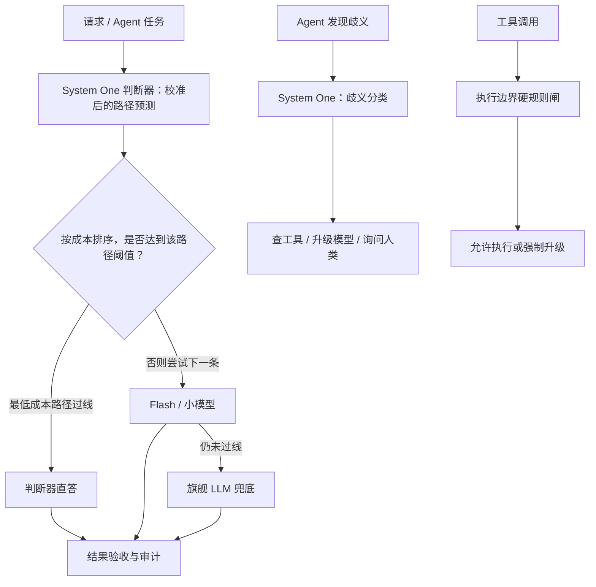
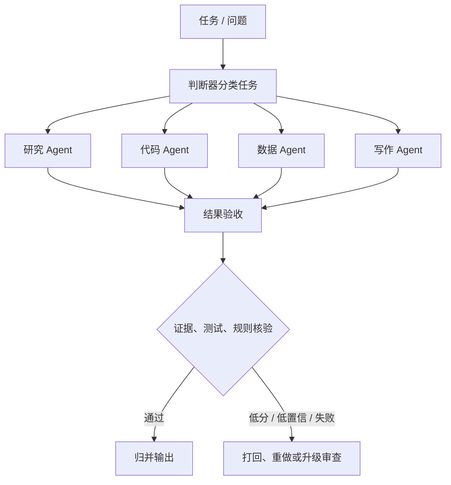

# 把“判断”从语言里拆出来：System One 校准路由架构

> 来源：Erfan.log《把“判断”从语言里拆出来：用 System One 做一套校准路由架构》
>
> **一句话概括：** 不让通用 LLM 用自由文本承担所有判断，而是引入一个输出类型化决策、且置信度经过校准的轻量判断器，把“走哪条模型路径、要不要问人、任务派给谁、结果是否需要升级”等决策从生成流程里拆出来；同时用独立的硬规则控制高风险操作。

## 1. 核心概念：System One / Jev

文章以 TypeSafe AI 的 Jev 为切入点，把 System One 类比为《思考，快与慢》里的快速、反射式判断；通用大模型更像承担复杂语言理解、规划和推理的 System Two。

Jev 的产品主张是 **“Decisions, not strings”——输出决策，而不是自由文本**。它不以生成一段自然语言为主要目标，而是直接在预定义的类型与选项中作判断。

| 对比维度 | 传统 LLM | System One / Jev 的文章描述 |
|---|---|---|
| 输出 | 自由文本，通常还要解析和校验 | 类型化决策：Choice、Score、Noul |
| 生成方式 | 自回归逐 token 生成 | 并行采样多个候选判断 |
| 典型用途 | 理解、生成、复杂推理 | 高频分类、打分、路由、门控 |
| 关键目标 | 生成有用答案 | 判断结果与置信度都可被程序消费 |
| 可信度关键 | 不能只看模型自报的信心 | 用业务数据校准置信度，使概率有可检验的含义 |

### 三种类型化原语

- **Choice（选择）**：从预定义选项中选择，例如选择任务类型、模型路径或子 Agent。
- **Score（评分）**：对候选结果或执行路径进行打分，例如评估某条路径完成任务的可能性，或进行软性质量筛查。
- **Noul（布尔概率）**：围绕是/否类判断给出概率，例如判断某项条件是否成立。

> 注意：输出格式正确，不等于判断本身正确。一个判断器即使不生成幻觉文本，也仍可能给出“格式完美但结论错误”的决策。

文章列出的 Jev 延迟、成本和加速倍数来自厂商材料；作者明确提示，严格的独立基准证据不足。因此应把“类型化判断 + 置信度校准”的架构思路，与产品宣传中的具体性能数字分开看。

## 2. 要解决的两个问题

### 2.1 全部调用旗舰模型，成本过高

真实业务中有大量重复、简单、高频的判断：分类、抽取、打分、模型路由，以及“是否继续执行”等。如果全部调用旗舰 LLM，就会让昂贵模型处理许多不需要它的工作。

常见的模型级联方案是“小模型先行，旗舰模型兜底”，但关键弱点在于：**路由器自身可能过度自信**，把本应交给强模型的任务误派给小模型。

### 2.2 Agent 过于频繁地询问人类

Agent 遇到任何不确定性都询问人，会把人类当作通用的查表工具和算力外挂。问题并不是 Agent 不该问人，而是它没有区分不同类型的不确定性。

## 3. 三层架构总览

文章将校准判断器放进三个位置：请求入口、歧义升级点、多 Agent 任务分派层。



核心分工可以压缩成四句话：

1. **通用 LLM 负责理解、发现和复杂推理。**
2. **System One 负责结构明确的分类、比较和决策。**
3. **验收层负责核查结果，不把“路由成功”当成“结果正确”。**
4. **高风险动作的权限与安全由执行边界的硬规则保障，而不是交给概率判断。**

## 4. 第一层：把判断器放到模型路由之前

### 4.1 不预测“任务有多难”，而预测“每条路径能否成功”

文章要求拆开三个问题：

1. 任务属于哪一类？——任务分类。
2. 某个执行模型能否完成当前任务？——路径成功率预测。
3. 最终结果是否正确？——结果验收。

这三者不能混为一谈。判断器有 95% 把握认为某任务“简单”，不等于某个小模型有 95% 概率答对，更不等于判断器自己直接作答有 95% 正确率。

因此，路由器应估计**不同执行路径的成功率与成本**，而不是只输出 `SIMPLE / MEDIUM / COMPLEX`。输入中还应包括工具清单、权限状态、会话上下文等会影响执行成败的信息。

### 4.2 按成本从低到高选择第一条过线的路径

候选路径可以是：

1. 判断器直接处理；
2. Flash 或其他低成本模型；
3. 旗舰模型兜底。

对每条路径分别估计成功概率，并设置与失败代价相匹配的阈值。选择**成本最低且预估成功率达到阈值**的路径；没有路径过线时，升级到旗舰模型。

示意伪代码：

```python
paths = ["JUDGE_DIRECT", "FLASH_LLM", "FRONTIER_LLM"]

est = judge.score(
    state=compose(request.text, session.context, tool_manifest, auth_status),
    targets=paths,  # 每条路径的校准后成功率估计
)

for path in sorted_by_cost(paths):
    if est[path] >= threshold[path]:
        return execute(path, request)

return frontier_llm(request)
```

**关键区别：** 路由置信度不等于任务成功率；路径预测也不替代结果验收。

## 5. 第二层：把“问人”变成一项分类决策

这是文章最强调的设计。Agent 发现歧义后，不应一律询问人类，而应先确定歧义的来源。

| 歧义类型 | 本质 | 应对方式 | 示例 |
|---|---|---|---|
| **信息缺口** | 所需数据不在上下文里 | 调用工具查询 | 不知道订单状态，就查数据库 |
| **能力缺口** | 当前模型推理能力不足 | 换更强模型或增加推理资源 | 复杂推理卡住，升级到旗舰模型 |
| **偏好 / 价值缺口** | 需要组织或用户给出目标、偏好、价值取舍 | 真正询问人类 | 是否放宽退款政策 |
| **不可逆 / 高风险** | 操作超出授权或后果难以撤销 | 由执行边界硬闸强制拦截并升级 | 删库、打款、对外发函 |

四类不是完全互斥的。例如，处理退款前可能先查订单历史（信息缺口），再确认是否可以突破公司政策（价值缺口）。复合歧义可以输出多标签或定义复合类型。

### 5.1 分工原则

> **LLM 负责发现歧义，判断器负责给歧义分类。**

发现含糊之处需要较强的语言理解能力；把已经发现的歧义归入结构化类别，则更适合交给类型化判断器。

### 5.2 如何更合理地询问人类

- **用决策卡，而不是开放式长问题。** 给出选项、各选项经校准的概率，以及每个选项的一句话后果，让人做明确选择。
- **可挂起的问题合并询问；阻塞问题立即询问。** 偏好确认可以排队、去重、攒批；紧急授权和时间敏感决策不能等待攒批。
- **宁可错问，不可错自动。** 把价值或责任问题误判成信息缺口，可能让 Agent 擅自替人做决定。低置信时应采用更保守的处理方式，必要时转人工。

### 5.3 误判成本是不对称的

- 错把信息缺口判成“需要人”：代价通常是多打断一次。
- 错把价值缺口判成“可以自动”：代价可能是越权替人做决定。

因此，“问人”的阈值要考虑错误成本，而不能只追求减少人工打断次数。不过，**高风险操作不能只依赖歧义分类器**；无论分类结果如何，都必须经过执行边界硬闸。

## 6. 第三层：把同一模式扩展到多 Agent 编排

路由对象从“选哪个模型”扩大为“把任务分给哪个子 Agent”。



### 6.1 分派不等于验收

- “任务应该交给谁”是结构化分派问题，适合判断器。
- “结果能不能用”需要看任务类型：研究报告要核查引用，代码要跑测试，不能只让判断器给一个分数。
- 先用测试、规则、证据做可验证的核查；判断器只负责经过验证的软性筛查，例如格式、完整性和明显缺陷。
- 低置信的验收不应该直接判失败，而应进入“验收不确定”状态并升级审查。

### 6.2 并行分派与递归升级

相互独立的子任务可以并行运行，并各自设置预算和时限。子 Agent 遇到困难时，由编排者决定：增加资源重跑、换专门 Agent、由编排者介入，或升级给人类。

整个过程可以重复为：

**分类 → 分派 → 验收 → 升级。**

文章称这是一种“分形架构”：请求级选模型、任务级选 Agent、结果级决定合并或打回、歧义级决定询问或升级，结构相似但粒度不同。

### 6.3 两个风险

1. **延迟叠加：** 多层串行判断会累加延迟，能并行就尽量并行，避免不必要的层级。
2. **相关失效（correlated failure）：** 如果执行者与验收者共享相似模型、训练分布和偏差，两者可能在同一处犯错，导致验收分数虚高。可以使用不同模型家族进行交叉检查，或对关键结果保留人工抽检。

作者也明确说明：多 Agent 分派加判断器验收，是本文推演成分较重的部分，公开端到端证据尚不足，应视为待验证设计，而不是已经被证明的结论。

## 7. 安全底线：校准负责优化，硬规则负责保命

这两类机制必须分开。

| 机制 | 处理对象 | 允许什么 | 不应该承担什么 |
|---|---|---|---|
| **概率线** | 信息缺口、能力缺口、常规路径选择 | 根据校准置信度调整阈值；在成本与质量间权衡 | 不能单独决定高风险操作是否可以执行 |
| **硬规则线** | 不可逆、越权、涉资金、涉安全的动作 | 在执行前按规则强制阻断或升级 | 不能依赖上游模型是否正确识别风险 |

**硬闸必须放在工具执行边界，而不只是分类结果之后。**

每次工具调用执行前，使用纯规则检查：

- 调用的工具是什么；
- 操作目标对象是什么；
- 涉及的金额或影响范围是多少；
- 是否具有明确授权。

任一必要条件不满足，就不执行并转人工或走授权流程。即使判断器报告 99% 置信度，也不能绕过硬闸。因为概率校准只表示长期统计意义上的正确率，并不意味着单次不会出错。

文章的成本不对称原则是：把简单任务升级给旗舰模型，损失的是钱；把本应由人决定的事情错误自动化，损失的可能是决策权与安全。

## 8. 工程落地方案

### 8.1 组件拆分

| 组件 | 职责 | 设计要点 |
|---|---|---|
| 判断器适配层 | 屏蔽不同实现的差异 | 统一提供 Choice / Score / Noul；底层可接托管 API、本地端点或自建模型 |
| 前置路由 | 估计路径成功率与成本 | 输入包含上下文、工具清单和权限状态；尽量无状态、可横向扩展 |
| 路由执行层 | 实际执行级联路径 | 各级独立设置超时、重试和熔断 |
| 歧义分类器 | 对 Agent 发现的歧义分类 | LLM 发现歧义，判断器负责类型化分类 |
| 决策卡生成器 | 把需人工决策的问题结构化 | 选项、校准概率、后果说明；支持排队和去重 |
| 硬规则闸 | 拦截越权和高风险调用 | 位于工具执行边界，采用规则表，不依赖概率输出 |
| 审计与抽检 | 追踪判断质量和漂移 | 记录判断过程，定期复核，超阈值时重新校准 |

文章提到的判断器来源包括：Jev 托管 API、兼容 wire format 的本地实现，以及“小参数模型 + 结构化输出”的自建路线。适配层能够统一调用形式，但**不能让不同模型的置信度天然可比**。

### 8.2 置信度校准怎么做

目标不是简单地让模型“输出一个百分比”，而是让这个数字在业务数据上具有统计含义：一组报告 80% 置信度的判断，长期来看应接近 80% 的实际正确率。

**数据来源**

- 使用自己的真实业务流量和人工标注结果；
- 让不同置信度区间都有样本覆盖；
- 文章给出的经验建议是，每种判断准备数百条以上标注，几千条可作为较舒适的起点，但这不是普适硬标准。

**方法顺序**

1. **Temperature scaling：** 用单个温度参数调整 logits，方法简单、较不容易过拟合，适合作为起点。
2. **Isotonic regression：** 用单调映射修正更复杂的非线性偏差；文章建议样本量较大时再考虑，小数据上容易过拟合。

**评估指标**

- **ECE（Expected Calibration Error）：** 按置信度分桶，衡量报告置信度与实际正确率之间的加权差距。
- **可靠性曲线（Reliability Diagram）：** 检查各置信区间是否系统性偏高或偏低。
- 同时关注分桶内样本量；样本太少可能让 ECE 看起来过于理想。

文章提到的 ECE 数值（如 0.05、0.02）是作者给出的经验参考，不应脱离业务风险直接当成统一验收标准。

**校准会漂移，也不能直接迁移。** 产品、流量、用户群或任务分布变化后，原有校准关系可能失效。更换判断器后，也要重新检查“报告 80% 是否仍对应约 80% 的实测正确率”。A 模型的 0.8 不一定等于 B 模型的 0.8。

**要把校准的全成本算进去。** 标注、持续抽检、重校准都需要人力。只有判断量足够大、判断任务足够同质时，自建方案才更容易抵消维护成本；否则托管服务或直接使用旗舰模型可能更划算。

### 8.3 分阶段上线：先影子运行

| 阶段 | 做什么 | 主要检查项 |
|---|---|---|
| Phase 0：影子模式 | 判断器只记录建议，不控制生产流量；抽样并行运行候选路径，比较反事实结果 | 校准情况；便宜路径是否导致质量下降 |
| Phase 1：小流量 | 只在白名单场景放行高预估成功率的低成本路径 | 放行后的错误率不高于基线；覆盖率逐渐提升 |
| Phase 2：歧义分类 | 把分类器接入 Agent 的“问人”环节 | 人工打断是否下降；是否出现漏判 |
| Phase 3：多 Agent 编排 | 引入子 Agent 分派和验收回传 | 单任务总成本与质量是否改善 |

影子模式不能只看“旧路径成功了没有”，因为这并不能证明判断器推荐的便宜路径也会成功。需要对一部分请求实际运行候选路径进行比较；涉及副作用的操作必须在沙箱中回放，不能重复执行真实操作。

建议同时跟踪五项指标：

1. 自动放行覆盖率；
2. 自动放行后的端到端错误率；
3. 高风险漏判数（目标为零）；
4. 总成本；
5. p95 / p99 尾部延迟。

### 8.4 最小端到端实验

文章给出的客服工单实验范例：

1. 取 500 条历史工单，标注参考处理路径和正确结果。
2. 建立基线：全部走旗舰模型，记录正确率、成本、延迟。
3. 接入判断器，估计各路径成功率，并选择达到阈值的最低成本路径。
4. 另抽约 100 条工单，让三条候选路径都执行一次，比较路由选择和实际最优路径的一致性；有副作用的操作应在沙箱进行。

重点衡量：

- 估计成功率与实测成功率的一致程度；
- 自动放行部分的端到端成功率；
- 相对基线的成本和 p95 延迟；
- 高风险漏判数。

文章给出的“成功率不低于基线减 1 个百分点、成本降至基线三分之一以下”只是示例判据，应按具体业务重新制定。

## 9. 设计中容易忽略的五件事

1. **校准漂移是常态。** 把抽样、监控和重新校准列入例行维护，而不是等事故发生后再处理。
2. **审计日志要能回放。** 至少记录谁作出判断、置信度、选择的路径和最终结果；还要尽可能保留当时的输入、模型版本、工具状态、策略阈值等，才能重现决策上下文。
3. **类型化输出不等于不需要语义理解。** 分类本身也需要语义能力。更准确的边界是：在已经验证的分布内，置信度可能可校准；面对分布外问题，判断器仍可能出错，而且输出格式仍然可能完全正确。
4. **厂商性能数字必须看分母。** 最好在自己的真实流量下评估延迟、成本、成功率和长尾表现，而不是直接套用厂商所报的加速倍数。
5. **校准不能跨模型照搬。** 统一接口不等于统一概率含义；切换模型后，应重新验证校准曲线和阈值。

## 10. 生态部分：文章写作时的观察

文章在发布时提到，判断器生态开始从单一托管产品扩展到兼容接口、本地模型和开源训练配方，并讨论了 Jev、Cloudflare Clef、AWS Strands Decider、StartLux-Decision、Intern-Decision、Cua-S1 等例子，也引用了 LLM-as-Jev 与 brier 等工作。

作者据此提出一个观点：**判断接口本身会越来越容易获得，真正有价值的差异在于概率是否经过校准，以及能否在目标业务分布中保持校准。**

这一节时效性很强，其中性能、基准成绩及厂商对比有些来自厂商自述。本文笔记保留其论点，但不把相关市场与性能说法视作已独立验证的事实。

## 11. 更深一层：注意力经济学

文章把系统里的资源分配分成三条线：

- **算力分配：** 判断器直答 → Flash → 旗舰模型；
- **注意力分配：** 工具自查 → 升级模型 → 人类决断；
- **风险控制：** 高风险操作由硬规则无条件把关。

过去系统通常核算 token 与计算成本，却容易把“打断一个人”视为免费。决策卡、攒批队列和置信度阈值，本质上是在减少不必要的人类打断，把人的注意力留给机器无法代替的目标、偏好和责任。

作者对人类角色的总结是：

> **把人的注意力从“能力补充”里解放出来，只留给“价值判断”。**

人类仍需要定义“什么才算好”、检查机器的结果与校准漂移，并对关键决策承担责任。AI 可以参与判断，却不能替人承担最终责任。

## 12. 文章结论与证据边界

### 可以带走的架构原则

- 将高频、结构清晰的判断从自由文本生成中拆出来，以类型化输出交给程序执行。
- 路由时预测每条执行路径的成功率和成本，而不是只预测任务难度。
- 置信度必须使用业务数据校准，并持续监控漂移。
- Agent 询问人类前，先区分信息、能力、价值和高风险问题。
- 多 Agent 系统中，分派与验收应分开；验收优先使用可验证的测试、规则和证据。
- 对不可逆、越权、涉资金和安全的动作，使用工具执行边界上的硬规则，而不是概率阈值。
- 通过影子模式和反事实比较验证收益，再逐步扩大上线范围。

### 作者自己保留的部分

- Jev 的速度、成本和加速倍数主要来自厂商发布材料，独立基准证据不足。
- “不生成文本”并不意味着不会作出错误判断。
- “多 Agent 分派 + 判断器验收”的端到端方案在文章中主要是架构推演，仍需实测。
- 级联路由、歧义分类、Planner-Executor 等并非全新的概念；文章的主要增量，是将校准置信度、歧义四分法、执行硬闸、注意力分级与分形分派组合成一套框架。

## 13. 术语速查

| 术语 | 含义 |
|---|---|
| System One | 文章中指快速、专门化的类型化判断组件 |
| Model Cascading | 按成本与能力逐级尝试模型，必要时升级到强模型 |
| Calibration（校准） | 让报告的置信度与实际正确率在统计上相匹配 |
| ECE | 置信度分桶后，预测置信度与实际正确率的加权差距 |
| Reliability Diagram | 展示预测置信度与实测正确率关系的可靠性曲线 |
| Counterfactual Evaluation | 同一请求测试不同候选路径，比较其真实结果与成本 |
| Shadow Mode | 只记录系统建议、不改变真实执行路径的观察阶段 |
| Correlated Failure | 执行者与验收者因共享偏差而同时出错，导致验收失效 |
| Hard Gate | 位于工具执行边界、不可被模型置信度绕过的规则闸 |
| Fractal Architecture | 不同粒度重复使用“分类 → 分派 → 验收 → 升级”模式 |

## 原文

[把“判断”从语言里拆出来：用 System One 做一套校准路由架构 — Erfan.log](https://erfanblog.top/post.html?p=system-one-agent-architecture)

