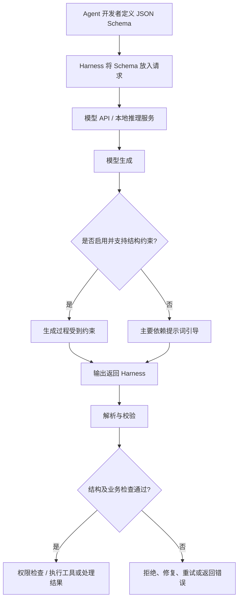
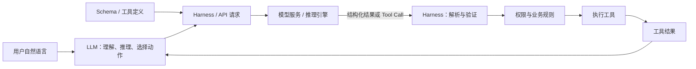

# Agent 中的 JSON、JSON Schema 与结构化输出

> [!summary] 核心结论
> Agent 由概率性的 LLM 与确定性的程序组成。**JSON 提供机器可解析的数据表示，JSON Schema 定义结构约束，Structured Output 是让模型按指定结构输出的能力，Constrained Decoding 则是在生成过程中实施约束的一种技术。** Harness 通常负责定义并传递约束、解析和校验结果、控制权限及执行工具；真正的生成约束一般由模型 API 或推理引擎实现。

## 1. 为什么 Agent 特别重视 JSON？

普通聊天只需要让人理解答案；Agent 则需要让程序根据模型输出采取行动。例如，模型不仅要说“我想搜索”，还需要明确说明调用哪个工具、参数是什么。

自然语言：

> 请调用搜索工具，查询 Python Agent。

结构化数据：

```json
{
  "tool": "search",
  "arguments": {
    "query": "Python Agent"
  }
}
```

第二种形式可以被程序稳定地读取：`tool` 是工具名称，`arguments.query` 是参数。若使用自然语言，Harness 可能不得不依赖字符串匹配、正则表达式或另一个 LLM 来猜测字段，容易因表达方式变化而失败。

### JSON 的主要价值

- **明确字段：** 将“要调用什么、参数是什么”表达为确定的字段和值。
- **便于解析：** 程序可以读取字段，而不必从一段自然语言中推断意图。
- **便于验证：** 可以进一步检查类型、必填字段、枚举值和取值范围。
- **便于衔接工具：** 工具调用请求、工具结果、Agent 状态等信息都可以采用结构化数据表示。

因此可以记为：

> **LLM 负责理解和生成，结构化数据负责表达约定，Harness 负责验证并执行。**

## 2. 必须使用 JSON 吗？

不必须。JSON 很常见，是因为它可读、易解析，并且广泛应用于 Web API 和工具调用生态。

其他可选格式还包括 YAML、XML、Protocol Buffers、MessagePack 等。真正重要的不是“必须 JSON”，而是通信双方需要一份稳定、明确、机器可解析的协议。

另外，LLM 并不是以 JavaScript 对象的形式直接“看见” JSON。请求中的 JSON 通常会经过序列化、消息封装和 tokenizer 等处理，最终以 token 序列进入模型。JSON 的价值在于它提供了规则化的表示，而不是因为模型内部原生使用 JSON 对象。

## 3. JSON Object 与 JSON Schema 的区别

可以理解为：**Schema 是规则，Object 是按规则填写的具体数据。**

### JSON Object：具体的数据

```json
{
  "name": "Tom",
  "age": 20
}
```

它回答：具体值是什么？

### JSON Schema：约束数据结构的规则

```json
{
  "type": "object",
  "properties": {
    "name": { "type": "string" },
    "age": { "type": "integer" }
  },
  "required": ["name", "age"],
  "additionalProperties": false
}
```

它可以描述：

- 允许出现哪些字段；
- 每个字段的数据类型；
- 哪些字段必填；
- 是否允许额外字段；
- 在支持的 Schema 关键字范围内，字段值还需要满足哪些约束。

类比：**Schema 像表格模板或合同，Object 像填好的表格或履行合同的具体数据。**

## 4. 规定 Schema 后，模型还会输出错误吗？

要区分两种情况。

### 情况 A：只在 Prompt 中描述 Schema

例如在提示词中告诉模型“请严格按以下 JSON 格式输出”。这是一条指令，不是强制规则。模型仍可能输出：

```text
好的，结果如下：
{"name":"Tom","age":20}
```

或者输出类型不匹配的值：

```json
{
  "name": "Tom",
  "age": "twenty"
}
```

原因是：LLM 本质上根据上下文生成 token。仅仅把规则写进 Prompt，并不会自动把生成空间限制成符合规则的内容。

### 情况 B：启用了 API 或推理引擎的结构化约束

如果模型 API 或本地推理引擎支持并启用了 Structured Output / Constrained Decoding，系统就能在生成时约束输出路径，通常比仅靠 Prompt 更可靠。

但仍要注意：

1. 具体约束能力取决于服务、模型、接口模式和所支持的 Schema 子集。
2. 请求可能失败、被拒绝、中断，或产生服务层错误；要按 API 的返回状态处理。
3. 结构合法不等于内容真实、合理，也不等于操作安全。
4. 约束生成也不能代替 Harness 的业务校验和权限控制。

## 5. Structured Output 与 Constrained Decoding 是什么？

### Structured Output

**Structured Output（结构化输出）** 是让模型输出符合指定结构（例如某种 JSON Schema）的能力或机制。它是一个较上层的概念，并不等于某一种特定算法。

### Constrained Decoding

**Constrained Decoding（约束解码）** 是实现结构约束的一种技术：在模型逐步生成 token 的过程中，根据语法或 Schema 维护允许的生成路径，排除不符合约束的候选路径。

普通生成可概括为：

```text
模型根据上下文生成 token
        ↓
得到完整文本
        ↓
再检查是否为合法 JSON
```

约束生成则更像：

```text
Schema / Grammar
       ↓
约束机制跟踪当前可接受的生成路径
       ↓
模型提出下一个 token
       ↓
约束机制排除不符合规则的路径
       ↓
继续生成
       ↓
得到受约束的结果
```

例如，Schema 要求 `age` 是整数，生成机制会限制该字段对应的输出，使其符合指定的结构和类型约束。底层实现并不一定简单等于“检查一个 token，再把它屏蔽掉”；实际机制可能通过语法状态、token 可接受集合或其他实现来完成约束。

**重要区分：**

- Structured Output：目标/能力——输出符合指定结构。
- Constrained Decoding：可能采用的实现技术——在生成过程中限制可接受的输出。
- JSON Schema：描述结构要求的规则。

三者有关联，但不是同一个概念。

## 6. 这部分由谁设计？在 Harness 内部吗？

通常由 Harness 与模型 API / 推理服务协作完成，而不是全部由 Harness 内部实现。



### 两侧的职责

| 环节 | 通常由谁负责 | 作用 |
|---|---|---|
| 设计 Schema | Agent 开发者 / 应用层 | 定义字段、类型、必填项等约束 |
| 在请求中启用结构化输出 | Harness / 应用调用层 | 按具体 API 的接口格式传递 Schema 和模式参数 |
| 实施生成阶段的约束 | 模型 API 服务端或本地推理引擎 | 若支持并启用，则限制生成路径 |
| 解析响应 | Harness | 将返回的内容转换成程序可操作的数据，或处理 API 已提供的结构化字段 |
| 校验结构与业务规则 | Harness | 检查字段、权限、范围和业务前置条件 |
| 执行工具 | Harness / Tool Runtime | 调用真正的 Python、JavaScript、Shell、HTTP 或数据库操作 |

云端模型通常由服务提供商实现生成时约束；本地模型则取决于选用的推理引擎和相关库是否支持受约束生成。Harness 可以调用这些能力，但并不意味着 Harness 自己实现了底层解码算法。

## 7. `JSON.parse()` 与 `JSON.stringify()`

在 JavaScript 中，`JSON.parse()` 和 `JSON.stringify()` 分别负责反方向的转换。

### `JSON.parse()`：JSON 字符串 → JavaScript 值

```javascript
const text = '{"name":"Tom","age":20}';
const obj = JSON.parse(text);

console.log(obj.name); // Tom
console.log(obj.age);  // 20
```

概念流程：

```text
JSON 格式的字符串
       ↓ JSON.parse()
JavaScript Object
       ↓
程序可以通过属性访问数据
```

注意：`JSON.parse()` 主要检查字符串是否符合 JSON 语法。**它不负责验证 JSON Schema，也不负责判断业务逻辑是否正确。**语法不合法时，通常会抛出异常，需要 Harness 捕获并处理。

### `JSON.stringify()`：JavaScript 值 → JSON 字符串

```javascript
const obj = { name: "Tom", age: 20 };
const text = JSON.stringify(obj);

console.log(text); // {"name":"Tom","age":20}
```

可以记为：

- `parse`：解析字符串，得到程序可操作的数据。
- `stringify`：把数据序列化成 JSON 字符串。

补充：很多模型 API 会把 Tool Call 的名称和参数放在专门的结构化字段中，不一定需要 Harness 从一整段普通文本里再调用 `JSON.parse()`。应按所用 API 的响应格式处理。

## 8. Harness 为什么不能只相信结构化输出？

**格式合法 ≠ Schema 合法 ≠ 业务正确 ≠ 操作安全。** 可以分成几层检查：

```text
模型/API 响应
    ↓
1. 响应状态检查
    ↓
2. JSON 语法解析（若需要）
    ↓
3. Schema 校验
    ↓
4. 业务逻辑校验
    ↓
5. 权限与风险检查
    ↓
6. 执行工具
```

例如，下面是语法合法的 JSON：

```json
{
  "tool": "delete_file",
  "arguments": {
    "path": "important.db"
  }
}
```

但 Harness 仍需判断：当前是否允许调用 `delete_file`？路径是否在授权范围内？是否需要用户确认？不能因为结构合法就直接执行。

### Harness 常见的恢复策略

- **Reject：** 拒绝不合法或不允许的请求。
- **Retry：** 将可修复的错误反馈给模型，再次请求生成。
- **Repair：** 对可安全、确定地修复的问题进行修复；不要盲目猜测关键参数。
- **Return error as tool result：** 工具执行失败时，将错误以模型可理解的形式返回，让 Agent 决定下一步。
- **Log / trace：** 记录失败阶段、工具请求和错误原因，方便调试与评估。

重试不应无限进行；应设置次数、成本和失败终止策略。

## 9. Function Calling 与上述机制的关系

Function Calling / Tool Calling 不是让 LLM 直接执行 Python 函数，而是让模型生成一条结构化的调用请求，再由 Harness 解释和执行。

```text
开发者注册工具及参数 Schema
              ↓
Harness 将工具定义发送给模型
              ↓
LLM 选择工具并生成 Tool Call
              ↓
Harness 解析 / 校验调用
              ↓
权限与风险检查
              ↓
Harness 调用真实函数
              ↓
收集工具结果
              ↓
将结果提供给 LLM，继续 Agent Loop
```

工具调用的参数通常会以 JSON 形式表达，但 Tool Calling 与一般的 JSON 文本输出并不完全相同：许多 API 会用专门的消息类型或字段表示 Tool Call。Harness 应优先依据 API 的结构化响应，而非从自然语言中猜测调用意图。

## 10. 最终心智模型



> [!important] 一句话记忆
> **JSON 是数据表示；JSON Schema 是结构规则；Structured Output 是结构化输出能力；Constrained Decoding 是生成阶段实施约束的一种技术；Harness 负责把这些机制接入 Agent 工作流，并在执行前做独立验证与权限控制。**

## 参考资料

- [OpenAI API 文档：Structured Outputs](https://platform.openai.com/docs/guides/structured-outputs)
- [JSON Schema 官方网站](https://json-schema.org/)
