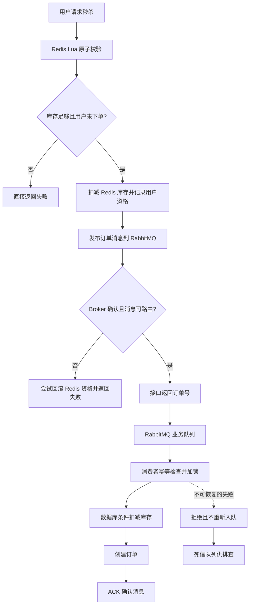

# Redis 与消息队列的关系及选型指南

## 一、核心结论

**Redis 和消息队列并非完全相同的技术类别，但它们在“消息传递与异步处理”功能上存在交集。**

- **Redis** 首先是一种数据存储系统，提供 String、Hash、List、Set、Stream 等数据结构，可用于缓存、计数、状态存储，也能实现一定程度的消息队列。
- **消息队列（Message Queue，MQ）** 是一种消息传递与异步处理机制，重点是让生产者和消费者解耦，并管理消息投递、消费确认、失败恢复、积压、路由等问题。
- **Redis Streams** 是与专业消息中间件比较时更合适的 Redis 功能。它支持消息记录、消费组、ACK 和待处理消息恢复等能力。
- **RabbitMQ、Kafka、RocketMQ 等** 是专门面向消息传递或事件流场景设计的中间件，通常提供更丰富的消息管理和运维能力。

可以这样理解：

> Redis 像一个提供多种存取方式的仓库；专业消息中间件更像一套物流系统，除了暂存货物，还要负责分发、签收、异常处理与积压管理。

这个类比只用于理解概念，不能据此认为 Redis 完全没有消息能力，或专业 MQ 自动保证绝对可靠。

## 二、Redis 和消息队列是不是同一个维度？

严格来说，**不是同一层面的概念**：

| 维度 | Redis | 消息队列 / MQ |
|---|---|---|
| 本质定位 | 数据存储系统、数据结构服务 | 消息传递与异步处理机制，通常由中间件实现 |
| 首要用途 | 缓存、计数、状态存储、集合操作等 | 服务间异步通信、任务排队、事件分发 |
| 能否实现队列 | 能，尤其可利用 List、Streams | 核心能力就是管理消息的传递和消费 |
| 比较时应关注 | 使用了什么数据结构、持久化与消费逻辑如何设计 | 产品提供什么消息语义、路由、确认和恢复机制 |

两者的关系不是简单的“谁替代谁”，而是：**用 Redis 实现消息队列，与使用专业消息中间件实现消息队列，是两种技术方案。**

## 三、为什么 Redis 能够替代一部分消息队列场景？

### 3.1 消息队列的基本模型

```text
生产者 Producer
      |
      v
消息存储 / 队列
      |
      v
消费者 Consumer
      |
      v
业务处理
```

如果一个系统能够保存消息、让消费者读取消息，并管理消费状态，就可以实现一个基本的队列模型。Redis 的不同数据结构可以承担其中一部分职责。

### 3.2 Redis 常见消息实现方式

| Redis 功能 | 适合的场景 | 需要注意的限制 |
|---|---|---|
| Pub/Sub | 实时通知、广播 | 消息通常不为离线订阅者保留，不适合要求可靠补消费的任务 |
| List | 简单任务排队、先进先出消费 | 需要自行设计确认、处理中断、重试、死信等机制 |
| Streams | 消费组、消息确认、待处理消息恢复、轻量级异步任务 | 仍需规划内存容量、持久化、消息清理、故障恢复与监控 |

Redis Streams 常用命令包括：

- `XADD`：向 Stream 添加消息。
- `XREADGROUP`：消费组读取消息。
- `XACK`：确认消息已处理。
- `XPENDING`：检查待确认消息。
- `XCLAIM` / `XAUTOCLAIM`：认领或恢复长期未处理的消息，具体适用性取决于 Redis 版本。

因此，与 RabbitMQ 对比时，更适合比较 **Redis Streams 与 RabbitMQ**，而不是把 Redis 的所有功能笼统地当成一个消息队列。

### 3.3 为什么仍然需要专业 MQ？

实现一个“可以排队”的结构，与系统化地处理分布式消息的可靠性，是两回事。常见问题包括：

- 生产者发出的消息是否真的到达 Broker？
- 消费者处理失败后，是否需要重试？重试多少次？
- 失败消息进入什么位置，如何排查和恢复？
- 多类消息如何路由到不同的队列或消费者？
- 如何限制消费者一次获取的未确认消息数量？
- 如何监控消息积压、消费延迟和失败率？
- Broker 重启、机器故障或网络分区时，消息如何恢复？

Redis Streams 已经提供其中一些基础机制，但应用仍然需要设计和运维相应的处理策略。RabbitMQ 等专业 MQ 通常会提供更完整的消息投递确认、路由、消费确认、死信处理和管理能力。

## 四、Redis 与专业 MQ 的关键区别

| 对比维度 | Redis Streams | RabbitMQ（典型业务 MQ） |
|---|---|---|
| 主要定位 | Redis 中的消息流数据结构 | 专业消息代理与队列系统 |
| 消息存储 | 依赖 Redis 的内存、持久化、复制和内存管理策略 | 可配置持久化消息与持久化队列；高可用取决于队列类型与部署 |
| 生产端确认 | `XADD` 返回成功表明 Redis 接受了写入，但不等于业务端到端完成 | Publisher Confirms 可确认 Broker 对发布消息的处理结果；还需处理无法路由的消息 |
| 消费端确认 | 消费组支持 `XACK` 和待处理消息管理 | 支持消费者 ACK/NACK 与未确认消息重新投递 |
| 路由模型 | 通常由 Stream key 与应用逻辑组织 | Exchange、Binding、Routing Key 等路由模型 |
| 失败处理 | 通常需要自行组合待处理消息、重试、补偿与死信逻辑 | 可通过拒绝/不重新入队、死信交换机等机制组织失败流程 |
| 消费者流控 | 需要根据消费方式自行设计 | 支持 prefetch 等消费端流控参数 |
| 延迟与 TTL | 通常需要自行实现或组合其他机制 | 支持 TTL；延迟消息方案仍需结合具体配置或插件能力评估 |
| 运维与观察 | 可用 Redis 工具与自建监控观察 | RabbitMQ Management 插件等可提供队列与消息指标 |
| 额外成本 | 如果已有 Redis，可复用现有基础设施 | 一般需要额外部署、托管或运维 Broker |

### 几个容易混淆的点

**1. Redis 并非没有持久化能力。**

Redis 支持 RDB、AOF 等持久化机制，也支持复制；但持久化配置、复制方式、故障切换和消息清理策略都会影响消息安全性。

**2. RabbitMQ 也不是“天然绝对可靠”。**

需要合理配置消息持久化、队列持久化、生产者确认、消费者确认以及高可用队列。单靠把消息发给 Broker，不能证明消息已经被业务成功处理。

**3. 吞吐和延迟不能只按产品名称判断。**

Redis 通常具有较低的访问延迟；消息中间件可能为了持久化、确认、复制或路由付出额外开销。具体性能取决于消息大小、持久化策略、确认方式、并发、部署规模和业务处理逻辑。

## 五、消息队列的核心价值

### 5.1 异步解耦

生产者不需要同步等待所有下游业务处理完成。比如订单创建后，通知、积分和统计可以由不同消费者异步处理。

```text
订单服务
   |
   v
消息中间件
   |-----------> 通知服务
   |-----------> 积分服务
   `-----------> 数据统计服务
```

### 5.2 削峰填谷

流量突然增大时，消息先进入队列，再由消费者按处理能力逐步消费，降低下游数据库或服务瞬时承压。

但队列不是无限容量的：如果生产速度长期高于消费速度，积压仍会增加，最终可能耗尽内存、磁盘或存储配额。因此还需要设置容量告警、扩容和流量治理策略。

### 5.3 失败隔离

下游出现短暂故障时，生产端不必同步承担全部失败影响。配合重试、死信、告警和补偿机制，可以让异常消息被隔离与处理。

### 5.4 消息不等于“只执行一次”

消息可能被重复投递。例如：消费者已经写入数据库，但在发出 ACK 前进程崩溃，Broker 可能重新投递同一条消息。

因此，消息系统通常需要接受至少一次投递带来的重复可能，并在业务侧实现**幂等性**。常用手段包括：

- 通过业务唯一键识别重复请求。
- 使用数据库唯一索引作为最终约束。
- 对重复消息进行安全确认，而不是重复执行副作用。

## 六、常见消息队列及选型方向

| 技术 | 典型定位 | 优先评估的场景 | 主要注意点 |
|---|---|---|---|
| **Redis Streams** | Redis 内的轻量级消息流 | 已有 Redis、任务量适中、希望减少基础设施的应用 | 消息保留、内存上限、持久化、待处理消息恢复需要明确设计 |
| **RabbitMQ** | 通用业务消息代理 | 订单异步处理、业务任务、灵活路由、失败消息管理 | 需学习 Exchange、Queue、Binding、ACK、Confirm、DLX 等概念 |
| **Apache Kafka** | 分布式事件流平台 | 日志、埋点、数据管道、实时分析、事件保留与重放 | 需设计分区、消费位点、保留策略、顺序性和集群运维 |
| **Apache RocketMQ** | 业务消息中间件 | 电商交易、业务事件、延迟消息、事务消息等 | 关注具体版本、部署形态、消息语义与运维能力 |
| **Apache Pulsar** | 面向多租户和大规模事件流的消息平台 | 多租户、大量主题、跨地域复制、分层存储等复杂场景 | 架构与部署运维相对复杂，不一定适合小型项目 |
| **NATS JetStream** | NATS 的持久化消息与流能力 | 轻量、低延迟的分布式消息通信，并需要持久化与回放 | 要区分基础 NATS Pub/Sub 与 JetStream 的持久化能力 |

以上是常见的起步方向，而非严格边界。例如 Kafka 也可以承载业务事件，RabbitMQ 也能承担事件分发。最终仍应依据消息模型、可靠性目标、规模和团队运维能力判断。

## 七、如何选择：五步判断法

### 第一步：确认消息丢失的影响

- 普通通知、可重算任务：可考虑轻量方案。
- 订单、支付、库存等关键业务：重点设计持久化、副本、确认、幂等、重试和补偿。

### 第二步：确定消息分发模型

- 一个任务由一个消费者组中的某个消费者处理：工作队列模型。
- 多个独立业务都需要读取同一个事件：发布订阅或多消费组模型。
- 需要按业务类型路由：检查是否需要 Exchange、Topic、订阅过滤等能力。

### 第三步：明确消息保留与回放要求

- 短暂排队，处理后即可删除：普通工作队列可能足够。
- 需要长期保留、多个下游独立消费、回放历史事件：重点评估 Kafka 等事件流平台及其保留策略。

### 第四步：估算吞吐和积压

至少估算：

- 平均与峰值消息速率。
- 单条消息大小。
- 消费者处理耗时及可扩展性。
- 下游故障期间可能累积的消息量。
- 积压的可接受持续时间，以及磁盘/内存容量。

不能只看正常情况下的 QPS，还要验证消费端停摆或下游变慢时的积压情况。

### 第五步：比较总工程成本

如果 Redis 已经稳定部署，而需求只是简单异步处理，Redis Streams 可能更经济。若需要复杂路由、失败消息治理和运维观察，专业 MQ 的内建能力可能更划算。对于大规模事件数据与回放需求，则应评估事件流平台。

## 八、以秒杀下单为例：Redis 与 RabbitMQ 如何协作

> 案例依据：用户提供的《RabbitMQ 秒杀消息队列改造讲解》。以下为其中的核心流程与可靠性要点整理。

这个案例的关键不是“RabbitMQ 替换整个 Redis”，而是**Redis 继续负责秒杀资格校验，RabbitMQ 接管异步订单消息传递**。

### 8.1 业务流程



### 8.2 为什么要引入 RabbitMQ？

1. **削峰填谷：** Redis Lua 先筛掉库存不足、重复下单等请求，只有获得资格的请求才发送消息；消费者按能力逐步写入数据库。
2. **异步解耦：** HTTP 接口不必同步等待数据库完整落单流程，减少用户请求的同步工作。
3. **失败隔离：** 消费失败的消息可进入死信队列，避免异常订单消息无休止地循环重试。
4. **运维可观测：** 可以监控业务队列和死信队列积压，并针对异常消息做排查。

### 8.3 RabbitMQ 中的关键概念

| 概念 | 在案例中的作用 |
|---|---|
| Producer | 秒杀服务，向 RabbitMQ 发布订单消息 |
| Exchange | 接收并路由生产者发出的消息 |
| Queue | 保存等待消费者处理的订单消息 |
| Routing Key | 与 Exchange 的绑定规则匹配，决定消息路由方向 |
| Publisher Confirm | 判断 Broker 对发布消息的确认结果 |
| Publisher Return / Mandatory | 检测消息到达 Exchange、但没有匹配队列的情况 |
| Consumer ACK | 业务处理成功后确认消息，可以从队列中移除 |
| NACK / Reject | 表示拒绝消息；是否重新入队影响后续处理 |
| DLX / DLQ | 死信交换机 / 死信队列，用于隔离符合死信条件的消息 |
| Prefetch | 限制消费者未确认消息的预取数量，帮助进行流控 |

**Publisher Confirm 与 Consumer ACK 不是同一回事：**前者关注生产者发布到 Broker 的结果；后者关注消费者是否确认处理了消息。两者不能互相替代。

### 8.4 这个方案的可靠性边界

该案例使用生产者确认、无法路由检查、持久化队列与消息、手动 ACK、死信队列和消费幂等等机制，分别处理不同环节的风险。但仍有需要注意的边界：

- **跨系统操作窗口：** Redis Lua 已扣库存，但应用在发送 RabbitMQ 消息前崩溃，可能造成资格已扣、消息未发出的不一致。
- **回滚也可能失败：** 若消息发送失败后的 Redis 回滚失败，仍可能出现库存或资格标记不一致。
- **至少一次投递会重复：** 消费者在业务写入后、ACK 前崩溃，消息可能再次投递，需要幂等处理。
- **死信不是自动修复：** 死信队列只隔离异常消息；还需要监控、告警、人工或自动化排查与安全重放流程。
- **数据库约束仍然重要：** 业务查重和分布式锁有帮助，但数据库唯一约束应作为防止重复订单的重要保护。案例原文也指出，其给出的数据库结构缺少 `(user_id, voucher_id)` 唯一索引，需结合实际 schema 核实。

生产级设计可进一步考虑可靠消息记录、事务性消息方案、补偿流程和定期对账。Redis 与 RabbitMQ 是两个独立系统，普通的先后调用不能构成跨系统原子事务。

## 九、推荐学习路线

结合 Spring Boot 后端开发，建议按下面顺序学习：

1. **理解消息模型：** Producer、Broker、Queue、Consumer、ACK，以及异步解耦和削峰填谷。
2. **用 Redis Streams 入门：** 实践 `XADD`、消费组、`XACK`、待处理消息、重试与清理策略，理解哪些逻辑需要应用自己维护。
3. **学习 RabbitMQ：** 重点掌握 Exchange、Queue、Binding、Routing Key、Direct/Topic/Fanout、Publisher Confirm、Return、Consumer ACK/NACK、DLX、prefetch。
4. **完成可靠性练习：** 模拟生产端断连、消费者处理失败、消费中途崩溃、重复投递、死信积压等情况，验证幂等、重试与告警。
5. **再学习 Kafka 或 RocketMQ：** 在真正有事件流、历史回放、大规模吞吐或特定业务消息语义需求时，再比较它们的设计。

## 十、最后总结

可以用三句话记住：

1. **Redis 是数据存储系统；消息队列是消息传递与异步处理机制。** 两者不是同一个抽象层面，但 Redis 可以实现队列功能。
2. **Redis Streams 适合轻量消息需求；RabbitMQ 适合需要丰富业务消息治理能力的场景；Kafka 更偏向可持久化的事件流与数据管道。** 这只是常见选型方向，不是硬性边界。
3. **选择 MQ 不等于自动解决可靠性。** 生产者确认、消费者确认、持久化、重试、死信、幂等和业务补偿各自解决不同问题，需要组合设计。

## 参考

- 用户提供的资料：`RabbitMQ秒杀消息队列改造讲解.pdf`
- Redis Streams：<https://redis.io/docs/latest/develop/data-types/streams/>
- RabbitMQ Publisher Confirms：<https://www.rabbitmq.com/docs/confirms>
- RabbitMQ Dead Letter Exchanges：<https://www.rabbitmq.com/docs/dlx>
- Apache Kafka Documentation：<https://kafka.apache.org/documentation/>
- Apache RocketMQ Documentation：<https://rocketmq.apache.org/docs/>
- Apache Pulsar Documentation：<https://pulsar.apache.org/docs/>
- NATS JetStream Documentation：<https://docs.nats.io/nats-concepts/jetstream>
