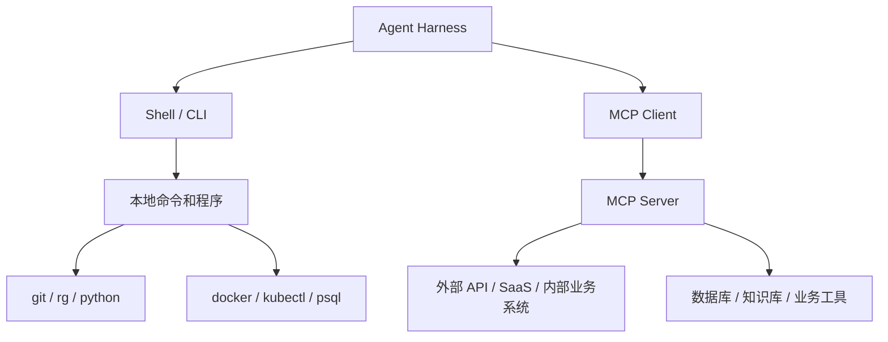
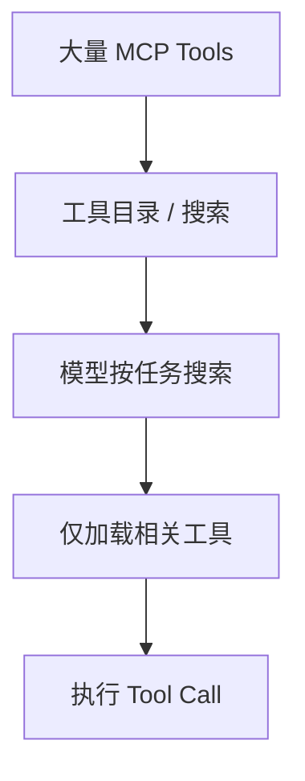
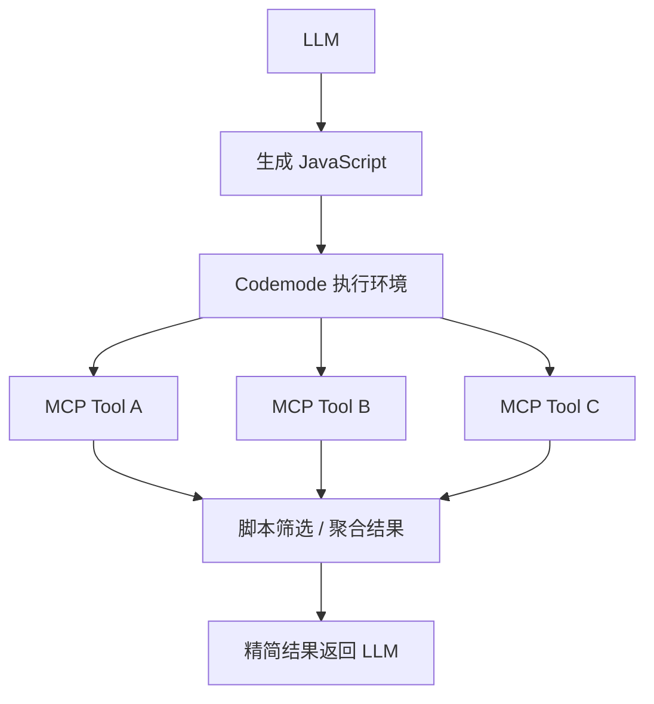
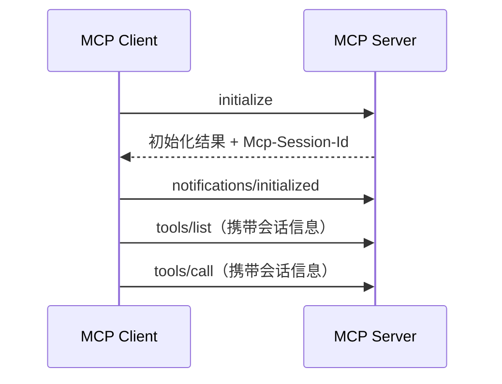
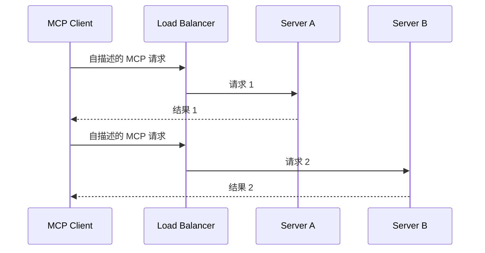
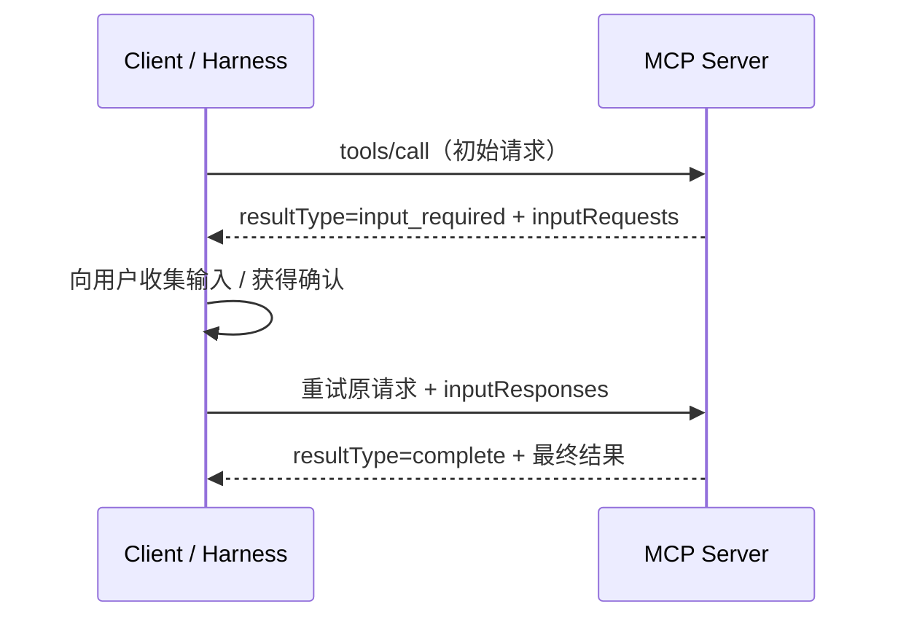
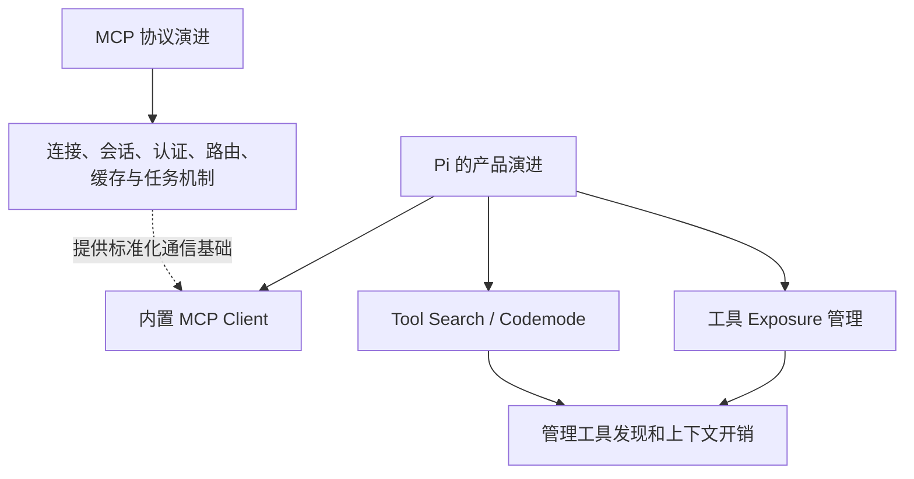
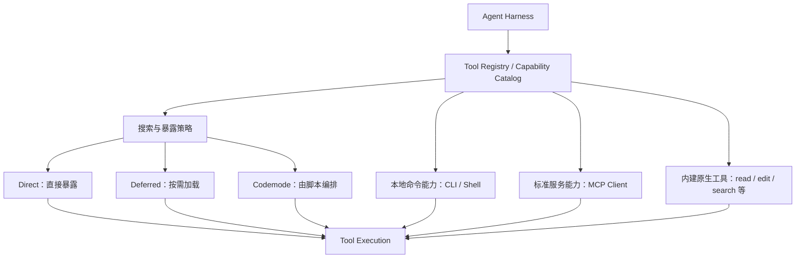

# CLI、MCP 与 Pi 的设计取舍和协议演进

> [!abstract] 核心结论
> - **CLI 与 MCP 不是非此即彼。** 本地操作系统能力、成熟命令行工具通常优先 CLI；服务化、结构化、需要跨 Agent 复用的能力，更值得考虑 MCP。
> - **Pi 以前不内置 MCP，是一种极简化的产品取舍，而不是技术上不能支持。** Pi 曾建议用 CLI、README/Skills 或扩展实现外部能力。
> - **Pi 在 0.99.0（2026-09-29）中加入内置 MCP、Tool Search 和 Codemode。** 它并没有因此放弃极简理念，而是通过工具暴露策略和按需发现管理 MCP 的成本。
> - **MCP 的 2026-07-28 规范更新与 Pi 新增 MCP 支持是两件相关但不能直接画等号的事。** 新规范着重于协议层无状态化、路由、缓存、交互和认证；Pi 的更新着重于客户端如何接入和管理工具。

## 1. CLI 与 MCP：用途和区别

### 1.1 两者的基本模型



- **CLI（Command-Line Interface）**：以命令、参数、标准输入输出为主要接口。Agent 通过 Shell 调用命令，例如 `git status`、`rg "TODO" .`、`python test.py`。
- **MCP（Model Context Protocol）**：用于让 AI 应用以标准化协议发现并调用外部工具、读取资源或使用提示模板。MCP Client 与 MCP Server 按协议交换结构化消息。

可以简化为：

- CLI 更像**命令式操作入口**。
- MCP 更像**标准化的工具/服务接口**。

这只是帮助理解的心智模型，不意味着 CLI 只能本地使用，也不意味着 MCP 只能远程使用。MCP Server 可以通过 `stdio` 运行，也可以通过 Streamable HTTP 提供远程服务。

### 1.2 为什么“能用 CLI 就用 CLI”有道理

1. **已有成熟工具**：Git、ripgrep、Docker、Python、npm、kubectl 等本来就有 CLI，通常不需要再封装一次。
2. **组合能力强**：Shell 可以用管道、重定向和脚本组合多条命令，例如：

   ```bash
   rg "error" logs/ | jq '.message' | sort | uniq
   ```

3. **接入成本低**：如果 Harness 已有可靠的 Shell 工具，模型只需生成命令；再建设一套 MCP Server 可能增加开发、部署和维护成本。
4. **适合 Coding Agent 的主要工作面**：读取文件、搜索代码、运行测试、Git 操作、构建项目等天然属于命令行生态。

但 CLI 也有代价：模型需要理解各命令各自的参数、输出格式和错误语义；对复杂 API 的认证、分页、重试、权限控制等也可能要由脚本自行处理。

### 1.3 MCP 的价值是什么

MCP 的核心价值不是“让 Agent 第一次拥有工具调用能力”——CLI 本身也能让 Agent 调程序；它的价值主要是**标准化不同服务的能力接入方式**。

- **结构化调用**：工具有名称、描述和参数 Schema，参数不是任意拼接的一整条 Shell 字符串。
- **服务封装**：将复杂 API 封装为 `search_issues()`、`create_ticket()`、`query_customer()` 等工具。
- **跨客户端复用**：同一个 MCP Server 可以被多个兼容的 MCP Client 接入，减少每种客户端各自实现集成的工作。
- **协议化通信**：可通过 `stdio` 或 Streamable HTTP 传输；远程部署时可结合认证、网关、审计和运维设施。

MCP 并不会自动保证工具设计合理、权限安全或返回值精简。这些仍然需要 Server 和 Harness 共同处理。

### 1.4 快速决策表

| 场景 | 通常优先考虑 | 原因 |
|---|---|---|
| 文件读写、搜索、Git、测试、构建 | CLI / 原生工具 | 已经有成熟接口，组合方便 |
| Docker、kubectl、ffmpeg 等命令行工具 | CLI | 直接调用现成能力通常最简单 |
| 已有成熟、可靠的服务端 CLI（如 `gh`） | CLI | 无须重复造一层集成 |
| 公司内部业务 API、知识库、工单系统 | MCP 或专用原生工具 | 可以把复杂 API 封装成结构化工具 |
| 多种 Agent 共享相同外部能力 | MCP | 有利于复用同一个 Server 实现 |
| 需要 OAuth、统一认证、服务端权限或审计 | MCP 值得考虑 | 可以在服务接口处集中实现，但不是协议自动附赠的完整安全方案 |
| 已经存在高质量 MCP Server，但没有好用 CLI | MCP | 直接复用生态能力 |

> [!tip] 实用原则
> **本地、命令行原生能力优先 CLI；服务化、结构化、跨 Agent 复用能力优先评估 MCP。** 如果一种能力已有稳定 CLI，通常不必为了“使用 MCP”而强行封装。两者可以在同一个 Harness 内共存。

## 2. Pi 为什么从“不内置 MCP”转向支持 MCP？

### 2.1 早期 Pi 的设计取舍

Pi 曾明确采用 **“No MCP”** 的产品哲学：核心尽量精简，外部能力优先通过 CLI + README/Skills，或者使用扩展来补充，而不是默认将 MCP 作为核心工具接入层。

这一取舍背后的工程考量可以归纳为：

- 很多开发任务已经可以通过 Shell、CLI 和文件系统工具完成。
- 每个 MCP Server 可能带来大量工具定义，包括名称、说明和参数 Schema，增加模型上下文负担与工具选择成本。
- 新增协议接入层也会带来 Server 配置、连接生命周期、认证、兼容性和故障处理等维护成本。
- Pi 希望核心能力保持简单，同时允许用户通过扩展定制工作流。

其中，“CLI 足够覆盖很多 coding 场景”和“避免过多工具注入”是对这套设计的合理解释；不能把每一点都视为 Pi 团队对外公布的唯一决策原因。

### 2.2 转折点：Pi 0.99.0

Pi 官方发布记录显示，**Pi 0.99.0 于 2026-09-29 发布**，新增内置 MCP、Codemode 和 Tool Search 支持，包括：

- 通过 `mcp.json` 或扩展注册 MCP Server。
- 支持 `stdio` 和 Streamable HTTP MCP Server，并支持 OAuth。
- 使用 `/mcp` 管理会话中的 MCP 工具，使用 `pi mcp add/list/login/...` 等命令管理服务配置。
- 将 MCP、Codemode、Tool Search 作为可配置的内置扩展，而不是要求每个场景都必须使用它们。

这说明 Pi 的选择从“默认不内置 MCP”转向“提供内置的 MCP 支持，但允许使用者按需启用和控制工具暴露”。

### 2.3 Pi 如何控制 MCP 的上下文和工具管理成本

Pi 的设计重点不只是连接 MCP Server，而是**决定工具以什么方式呈现给模型**。

| Exposure 模式 | 模型如何使用 | 适合场景 |
|---|---|---|
| `direct` | 工具直接出现在模型的可用工具列表中 | 工具少、常用、希望直接调用 |
| `deferred` | 工具先不全部声明；模型通过 Tool Search 搜索后再加载 | 工具很多、需要按需发现 |
| `codemode` | 工具可由 Codemode 脚本间接调用，不必逐个直接暴露给模型 | 需要组合、并行调用、筛选和聚合结果 |
| `hidden` | 工具注册但不对模型开放调用 | 有意禁用或限制某些工具 |

具体机制和可用模式可能随着 Pi 版本演化，应以当前官方文档为准。

#### Tool Search：按需发现

传统做法可能是把一个 MCP Server 的几十或几百个工具定义都暴露给模型。Tool Search 则允许模型先搜索工具目录，再把匹配的工具加载到可用工具集合中。



#### Codemode：让代码组合工具

Codemode 允许模型编写 JavaScript，在受控执行环境中调用 Pi 的工具。例如，脚本可以并行调用多个 MCP 工具、过滤结果、提取字段，最后只把必要信息返回模型。



它能减少“每次工具调用的原始结果都直接进入模型上下文”的情况，也能把多个工具调用的编排逻辑放进脚本中。不过这不意味着 Codemode 永远比直接调用更合适：简单且高频的工具仍可能适合 `direct`；脚本执行本身也需要安全边界、权限和错误处理。

### 2.4 Pi 的理念改变了吗？

更准确的理解不是“Pi 以前反对 MCP、现在认为 MCP 万能”，而是：

> **Pi 从“不在核心内置 MCP”，转向“可以原生接入 MCP，但通过暴露策略、Tool Search 和 Codemode 控制复杂度”。**

- CLI 仍然是本地开发和操作系统能力的重要入口。
- MCP 让 Pi 可以接入更多标准化的外部服务。
- Tool Search 和 Codemode 管理的是模型怎样发现、使用和组合这些工具。
- 通过内置扩展、配置和禁用选项，使用者不必在每个场景都启用全部机制。

这是一种从“减少能力种类”走向“提供能力，但有选择地暴露和加载”的设计方向。

## 3. MCP 规范演进：2026-07-28 更新

### 3.1 时间背景

本笔记以 2026-10-11 为整理时间。MCP 在 **2026-07-28** 发布了规范版本 `2026-07-28`，其上一正式规范版本为 `2025-11-25`。官方将这次更新描述为重要的协议架构升级，主要方向包括无状态协议核心、多轮请求、基于 HTTP Header 的路由、缓存、安全加固和扩展机制。

### 3.2 最大变化：协议级会话与初始化握手被移除

旧版本典型流程：



新版思路：



主要变化：

- 移除 `initialize` / `notifications/initialized` 握手流程。
- 移除 Streamable HTTP 的 `Mcp-Session-Id` 协议级会话机制。
- 请求携带协议版本、客户端能力等必要的元数据。
- 新增 `server/discover`，客户端可以在需要时提前查询服务端支持的版本、能力和身份；但通常不必先建立会话才能开始请求。
- 工具、资源和提示列表不再因为不同连接会话而变化。

**为什么重要？** 旧模型可能要求负载均衡器将客户端固定路由到持有会话状态的 Server 实例，或者需要共享会话存储。取消协议级会话后，普通请求更容易分配给任意服务实例，便于水平扩展。

> [!warning] 无状态不等于业务没有状态
> 如果工具需要跨调用保留浏览器实例、购物车、任务进度或工作流数据，服务端仍然可以有业务状态。新版鼓励使用显式句柄，例如 `browser_id`、`task_id`，由工具返回并由后续调用把它作为普通参数传回，而不是将状态隐藏在传输层的会话 ID 中。

### 3.3 MRTR：多轮请求交互

**MRTR（Multi Round-Trip Requests）** 用新的请求/响应轮次来处理服务端需要额外输入的场景，替代一些原本由服务端通过双向通道发起的请求，例如用户确认、补充参数等。



它的意义是：即使不依赖持久的双向会话，服务端也能表达“这项操作还缺少信息”。客户端负责收集信息，并在重试原请求时附上回答。

### 3.4 HTTP Header 路由

新版 Streamable HTTP 的 POST 请求增加了标准请求头：

- `Mcp-Method`：标识 MCP 方法，例如 `tools/call`。
- `Mcp-Name`：在相应请求中标识工具等目标名称。

这使 API Gateway 更容易根据方法或工具名实施路由、授权、限流和审计，而不必先解析 JSON-RPC 请求体的全部内容。规范还支持通过 `x-mcp-header` 将工具参数映射到自定义 HTTP Header。

示意：

```http
POST /mcp HTTP/1.1
MCP-Protocol-Version: 2026-07-28
Mcp-Method: tools/call
Mcp-Name: search
Content-Type: application/json
```

这是协议和网关基础设施更好衔接的一步，不意味着所有网关策略只靠请求头就能安全实现；仍然要验证身份、参数和具体权限。

### 3.5 工具目录和资源结果缓存

新版在若干列表或资源结果中使用 `ttlMs` 与 `cacheScope` 等缓存提示，并建议工具列表返回确定性顺序。

- `ttlMs`：结果可被视为新鲜数据的时间提示，单位为毫秒。
- `cacheScope`：如 `public` 或 `private`，用于界定共享中间层是否可以缓存。
- `tools/list` 等结果使用稳定顺序，可提高客户端缓存命中率，并帮助维持 LLM Prompt Cache 的稳定前缀。

要区分两个层面：

1. **协议结果缓存**减少重复请求和数据获取。
2. **Tool Search / 延迟加载**减少模型需要看到的工具定义数量。

前者不自动解决后者；对大型工具集而言，两类策略可以配合使用。

### 3.6 Tasks 被移到正式扩展

长期运行任务有时需要持续几十秒、几分钟甚至更久。新版将实验性的 Tasks 从核心协议中移到正式扩展 `io.modelcontextprotocol/tasks`，并调整了交互方式，包括通过 `tasks/get` 轮询任务状态、通过 `tasks/update` 提供客户端输入等。

这意味着：

- 普通 MCP 工具调用与长任务生命周期不必完全采用同一种阻塞式请求模型。
- Tasks 是扩展能力，不应假设所有 MCP Server 都一定实现它。
- 任务状态应由服务端明确管理，而不是依赖被移除的协议级会话。

### 3.7 OAuth 与安全机制调整

重点变化包括：

- 强化授权服务器 `iss` 参数验证，以缓解授权服务器混淆问题。
- 凭据与签发它们的授权服务器绑定，不能跨授权服务器复用。
- Dynamic Client Registration（DCR）正式弃用，未来转向 Client ID Metadata Documents（CIMD）；DCR 仍保留一段时间用于向后兼容。
- 新版采用明确的规范弃用政策，为实现者提供迁移窗口。

这并不代表“用了 MCP 就自动安全”。Server 仍需要进行最小权限设计、输入验证、凭据保护、用户确认、审计和危险操作控制。

### 3.8 其他需要留意的变更

新版还有一些协议清理和调整：

- 引入更正式的扩展机制，核心协议可保持精简，额外能力以扩展形式提供。
- 用 `subscriptions/listen` 等新机制调整订阅和变更通知模型。
- 删除或调整一些旧的 RPC、通知和日志控制方式。
- 旧式 HTTP+SSE 传输被正式弃用，鼓励使用 Streamable HTTP。
- Roots、Sampling 和 Logging 等旧能力也进入弃用路径；迁移时应查阅具体规范，不要只凭旧教程实现新客户端。

## 4. 这次 MCP 更新与 Pi 的变化是什么关系？

两件事时间接近，但属于不同层次，不能直接认定 Pi 是因为新版 MCP 规范才加入支持。



- **MCP 规范层**回答：客户端和服务端如何通信、如何发现能力、如何认证、如何交换结果。
- **Pi / Agent Harness 层**回答：哪些工具需要对模型可见、如何延迟加载、如何组合调用，以及如何控制结果进入上下文的规模。

Pi 官方 0.99.0 发布记录明确说明加入了 MCP 支持，但单凭这一点不能断言该版本完整实现了 `2026-07-28` 规范。做协议兼容性判断时，应单独查阅 Pi 版本文档和对应 SDK 的支持说明。

## 5. 设计自己的 Agent Harness 时，可以怎么借鉴？

可以把工具系统分为三层：



设计时优先回答这些问题：

1. **工具从哪里来？** 本地 CLI、内建工具、MCP Server，还是其他服务。
2. **模型什么时候看见工具？** 全量注入、延迟加载，还是通过搜索发现。
3. **调用由谁编排？** 模型逐次 Tool Call，还是脚本/工作流在一次调用中组合多个工具。
4. **权限在哪里检查？** Harness、MCP Server、外部业务 API，最好形成分层且明确的授权边界。
5. **如何处理工具输出？** 是否需要筛选、摘要、结构化返回，避免大结果无差别进入上下文。
6. **如何兼容协议演进？** 清楚支持的 MCP 版本、传输方式、扩展、认证与降级策略。

> [!important] 关键判断
> Agent Harness 的核心挑战不是单纯“怎么调用工具”，而是管理不断增长的工具集合：**发现、暴露、选择、授权、执行、编排、结果裁剪与可观测性**。MCP 解决标准化接入的一部分问题，CLI 负责命令行生态，两者都需要 Harness 做统一管理。

## 6. 术语速查

| 术语 | 含义 |
|---|---|
| CLI | 命令行接口，通常通过 Shell 执行程序并读写标准输入输出 |
| MCP Client | 将 MCP 协议接入到 AI 应用/Harness 的客户端部分 |
| MCP Server | 以 MCP 协议暴露工具、资源或提示等能力的服务端程序 |
| stdio | MCP Client 与本地 MCP Server 通过标准输入输出通信的传输方式 |
| Streamable HTTP | 用 HTTP 进行 MCP 请求/响应通信的传输方式 |
| Tool Schema | 工具的名称、描述和参数结构定义 |
| Tool Search / Deferred Loading | 先搜索，再将相关工具声明加载给模型的策略 |
| Codemode | 让模型编写脚本，由受控执行环境组合调用工具并处理结果的模式 |
| Exposure | 决定工具直接暴露、延迟加载、仅供脚本调用或隐藏的策略 |
| Stateless protocol | 协议本身不要求服务端维持协议级会话状态；不代表业务不能保存状态 |
| MRTR | Multi Round-Trip Requests；通过多轮请求/响应完成中途需要额外输入的交互 |
| Tasks extension | MCP 中面向长时间运行任务生命周期的扩展能力 |

## 7. 官方资料

> 以下链接用于进一步查阅；协议细节和客户端支持状态会随版本变化。

### MCP

- [MCP 2026-07-28 官方发布说明](https://blog.modelcontextprotocol.io/posts/2026-07-28/)
- [MCP 2026-07-28 规范变更记录](https://github.com/modelcontextprotocol/modelcontextprotocol/blob/main/docs/specification/2026-07-28/changelog.mdx)
- [MCP 2026-07-28 规范正文](https://github.com/modelcontextprotocol/modelcontextprotocol/tree/main/docs/specification/2026-07-28)

### Pi

- [Pi 0.99.0 发布记录：加入内置 MCP、Codemode、Tool Search](https://pi.dev/changelog/releases/0.99.0)
- [Pi MCP Servers 文档](https://pi.dev/docs/latest/mcp)
- [Pi Codemode 文档](https://pi.dev/docs/latest/codemode)
- [Pi Changelog](https://pi.dev/changelog)

---

## 一句话总结

**CLI 是命令行生态的高效接口，MCP 是 Agent 与外部服务之间的标准化接口；Pi 的变化是开始内置 MCP，同时用 Tool Search、Exposure 和 Codemode 管理工具复杂度；MCP 2026-07-28 的重点则是让协议更无状态、可路由、可缓存、可扩展，并强化认证与长期任务支持。**
