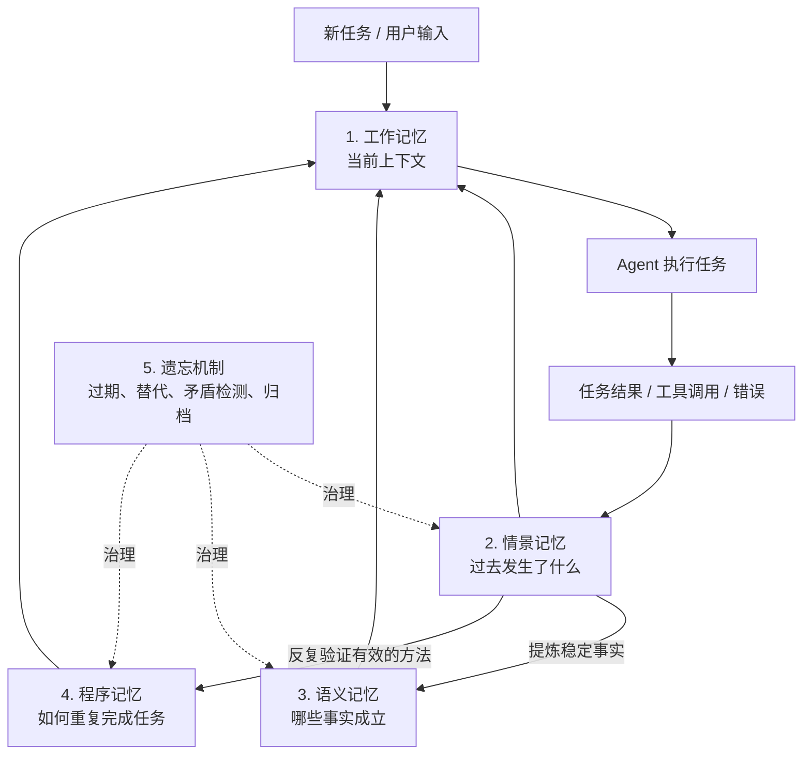
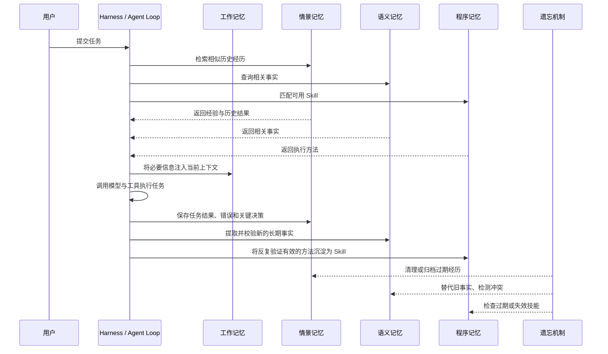
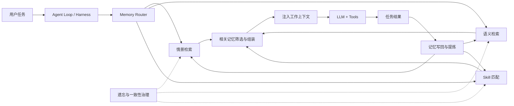

# Agent 记忆层的五层架构

> [!abstract] 核心观点
> Agent 记忆不是简单地保存聊天记录，而是把**当前上下文、历史经历、长期事实、可复用方法和记忆治理**组织成一个完整系统。五层分别是：工作记忆、情景记忆、语义记忆、程序记忆和遗忘机制。

## 一、整体架构



这五层并不是五个必须依次经过的存储桶。工作记忆承载当前任务；情景、语义、程序记忆提供不同类型的持久信息；遗忘机制横向管理记忆的生命周期。执行时，系统可以直接检索某一层的内容并注入工作记忆。

## 二、五层分别解决什么问题？

| 层级 | 核心问题 | 主要保存内容 | 常见实现 | 生命周期特点 |
|---|---|---|---|---|
| **1. 工作记忆**（Working Memory） | 当前正在处理什么？ | 系统提示词、当前对话、工具结果、检索内容、任务状态 | Context Window、上下文摘要 | 当前调用或当前会话；可能被压缩或淘汰 |
| **2. 情景记忆**（Episodic Memory） | 过去发生了什么？ | 任务描述、尝试过的方法、成功/失败结果、错误与修复、关键决策 | JSONL、日志、数据库 | 持久保存；通常设置保留期 |
| **3. 语义记忆**（Semantic Memory） | 哪些事实值得长期保留？ | 用户偏好、项目事实、实体、关系、配置、API 信息 | JSON、SQLite、向量库、知识图谱 | 通常长期保存；事实变化时需要更新或标记旧版本 |
| **4. 程序记忆**（Procedural Memory） | 怎样重复完成任务？ | 可复用步骤、所需工具、前置条件、成功标准、失败模式 | Skills、YAML/Markdown 文件、技能注册表 | 版本化管理；流程变化时需要更新、回滚或废弃 |
| **5. 遗忘机制**（Forgetting） | 什么应该删除、更新或作废？ | 它本身不是单一记忆内容，而是一组治理操作 | TTL、归档任务、版本管理、冲突检测 | 持续或定期运行，横跨其他记忆层 |

### 1. 工作记忆：当前上下文

工作记忆就是 Agent 本次调用实际能够看到的上下文，通常包含：

- 系统提示词与规则；
- 当前用户需求和对话历史；
- 工具调用结果、报错和检索到的文档；
- 当前任务进度及主动注入的记忆摘要。

它解决的是**当前任务中的上下文连续性**，不等于跨会话持久化。会话结束后，工作记忆中的信息未必仍然可用。

当上下文接近上限时，系统应先提取并保存重要决策、事实和任务状态，再压缩上下文，而不是直接截断而丢失关键进展。

### 2. 情景记忆：具体经历

情景记忆保存的是一次任务中实际发生的事情，而不只是总结后的结论。

例如，一次 Agent 安装任务可以记录：

- **任务**：安装某个 Agent 项目；
- **尝试**：执行 `git clone`；
- **结果**：由于代理配置错误而失败；
- **解决**：修正代理配置后重试成功；
- **经验**：下次安装前先检查代理配置。

情景记忆的主要价值是：新任务开始时，检索相似的历史任务，让 Agent 避免重走已经失败的路径。

**记录原则：**保存任务描述、关键操作、结果、错误与解决方案、重要决策和用户纠正；避免无差别保存冗长推理、整份原始文档和所有中间草稿。原始文件可通过 ID 或路径引用。

### 3. 语义记忆：长期事实与知识

语义记忆保存从历史经历中提炼出来、能够在其他任务中复用的事实。

例如：

- 情景记忆：某次安装由于 Python 版本不兼容而失败；
- 语义记忆：该项目要求 Python 3.12。

又例如：

- `项目 A → 使用 → PostgreSQL`
- `项目 A → 部署于 → AWS`
- `用户 → 偏好 → TypeScript`

语义记忆可以从简单的键值记录起步，也可以逐渐发展为具有实体、关系和校验规则的知识结构。

#### Ontology（本体层）有什么作用？

本体层规定系统中有哪些实体类型、关系类型和数据校验规则。例如：

- 实体类型：`user`、`project`、`api`、`config`；
- 关系类型：`prefers`、`owns`、`depends_on`；
- 校验规则：项目必须有负责人，偏好字段必须符合指定格式。

它的作用是让记忆结构化、可校验、可查询，减少知识库退化成无组织文本集合的风险。并非所有 Agent 都需要一开始就建立完整本体；简单场景可先使用 JSON 或 SQLite。

### 4. 程序记忆：可复用方法

程序记忆保存的是**如何执行任务的方法**，通常以 Skill 的形式表达。

例如：

- 语义记忆：项目通过 `npm run build` 构建，产物需要上传到 S3；
- 程序记忆：执行构建 → 检查构建产物 → 同步到 S3 → 请求线上地址验证返回状态。

一个可维护的 Skill 通常应包含：

- 名称与触发条件；
- 执行步骤；
- 必需工具与前置条件；
- 成功标准；
- 常见失败模式与排障方式；
- 版本号、最近使用时间和有效性信息。

原文建议：某类任务反复成功至少三次、步骤足够明确且所需工具可靠后，再考虑将方法提升为 Skill。“三次”是该文档提供的工程经验阈值，不是适用于所有项目的硬性标准。

技能不是永久正确的。部署流程、命令或工具版本发生变化后，需要更新版本、保留必要的回滚能力，并重新验证技能。

### 5. 遗忘机制：记忆治理

遗忘机制不是另一个普通的记忆库，而是贯穿情景、语义和程序记忆的生命周期管理机制。没有它，系统可能积累重复、过期和互相矛盾的信息。

| 操作 | 含义 | 示例 |
|---|---|---|
| **过期（Expiration）** | 按保留期限删除或归档低价值记录 | 归档超过保留期的普通调试日志 |
| **替代（Supersession）** | 新事实取代旧事实，旧版本可保留审计记录 | API 从 `/v1` 迁移到 `/v2` |
| **矛盾检测与处理** | 发现无法简单覆盖的冲突，自动处理或交由人工确认 | 记录中同时存在“偏好 Python”和“偏好 TypeScript” |
| **版本治理** | 更新、回滚或废弃失效的方法 | 部署流程更新后废弃旧版 Skill |

注意：新事实不必然意味着旧事实应当被物理删除；某些冲突也不能只凭时间戳判断。若两个说法可能都在不同范围或时间条件下成立，应保留范围和时间信息；无法确定时，应标记冲突并请求确认。

## 三、几个最容易混淆的概念

### 情景记忆 vs. 语义记忆

| 比较点 | 情景记忆 | 语义记忆 |
|---|---|---|
| 关注点 | 某件事发生过什么 | 系统当前认为哪些事实成立 |
| 典型形式 | 带时间、任务与结果的事件记录 | 实体、属性、关系或结构化事实 |
| 典型问题 | “上次怎么失败的？” | “这个项目使用什么数据库？” |
| 更新方式 | 新增经历、摘要、归档 | 校验、合并、替代、处理冲突 |

可以把它们理解为：情景记忆保存**经历材料**，语义记忆保存从经历及其他可信来源中组织出来的**知识结论**。语义事实不一定只能从情景记忆提取，也可能来自用户明确告知或权威文档。

### 语义记忆 vs. 程序记忆

- **语义记忆是“知道什么”**：项目使用 PostgreSQL，部署目标是某个环境。
- **程序记忆是“知道怎么做”**：按照哪些步骤完成迁移、部署、验证和回滚。

语义事实可以帮助判断是否调用某个 Skill；Skill 则把事实和工具组织成可执行流程。

### 工作记忆 vs. 持久记忆

工作记忆是模型当前请求能够访问的信息集合；情景、语义与程序记忆则是在请求之外保存、按需检索的信息。持久记忆不会自动发挥作用，Harness 必须实现检索、筛选、注入和写回。

### 遗忘机制 vs. 删除文件

遗忘不是简单地定时删除文件。它可能是删除、归档、降权、标记旧版本、检测冲突或要求人工确认。关键目标是确保检索到的信息仍然相关、可信且没有被旧版本误导。

## 四、记忆闭环：一次任务如何流过五层？



### 任务开始前

1. 识别任务类型和项目范围；
2. 检索相似的情景记忆，避免重复已知错误；
3. 查询相关语义事实；
4. 判断是否存在适用且有效的 Skill；
5. 只把与本次任务相关的信息注入工作记忆。

### 任务完成后

1. 保存关键任务经历、结果和决策；
2. 从经历或可信来源中提取候选事实，并校验后更新语义记忆；
3. 判断重复成功的方法是否值得沉淀为 Skill；
4. 触发必要的过期、替代、冲突检测和归档机制。

## 五、如何逐步落地？

不要一开始就搭建复杂知识图谱。按照实际痛点逐层增加能力更容易验证收益。

| 阶段 | 实现内容 | 最小方案 | 验收标准 |
|---|---|---|---|
| 1 | 情景记忆 | JSONL 追加任务结果 | 下一次任务能检索到上次失败及解决办法 |
| 2 | 情景检索 | 关键词、标签或相似度检索 | 新任务开始前会查询历史经验 |
| 3 | 语义记忆 | JSON 或 SQLite 存储长期事实 | 跨会话能够正确调用用户偏好和项目配置 |
| 4 | 结构化校验 | 定义实体、关系和必需字段 | 写入数据符合约定格式，重复事实可识别 |
| 5 | 程序记忆 | 将反复验证的方法保存为 Skill | 相同类型任务能够触发并执行已保存方法 |
| 6 | 遗忘机制 | TTL、事实替代、冲突标记、Skill 版本 | 过期信息不再被当作当前事实使用 |
| 7 | 工作记忆联动 | 上下文溢出前保存重要状态，检索后注入摘要 | 多会话任务可以延续进度，不必重新读取全部材料 |

### 最小数据模型示意

**情景记忆（JSONL，一行一个事件）**

```json
{"task_id":"task-001","timestamp":"2026-10-11T10:00:00+09:00","task":"部署前端","approach":"构建后同步到对象存储","outcome":"failure","error":"构建产物不存在","resolution":"先运行构建并检查产物","project":"demo-app"}
```

**语义记忆（结构化事实）**

```json
{
  "entity": "demo-app",
  "entity_type": "project",
  "relation": "uses_database",
  "value": "PostgreSQL",
  "source_episode": "task-001",
  "status": "active",
  "updated_at": "2026-10-11"
}
```

**程序记忆（Skill 概念结构）**

```yaml
name: deploy-frontend
trigger: 部署前端应用
preconditions:
  - 依赖已安装
  - 部署凭据可用
steps:
  - 运行构建命令
  - 检查构建产物
  - 上传构建产物
  - 请求线上地址验证结果
success_criteria: 构建成功且线上服务验证通过
failure_modes:
  - 构建失败：检查运行时版本与依赖
  - 上传失败：检查权限与目标路径
version: 1
```

以上仅为结构示例，不是完整的生产实现；实际系统还应考虑数据校验、权限隔离、并发写入、审计、来源可信度及错误恢复。

## 六、在 Agent Harness 中如何理解与实现？

以 Pi、OpenCode 等 Harness 为例，可以把五层看作可组合的记忆能力，而不是要求修改模型本身。



### 推荐的职责边界

- **Harness / Agent Loop**：决定何时检索、何时注入、何时写回以及何时触发压缩。
- **记忆路由与检索**：根据任务类型、项目范围和相关性选择需要查询的记忆层。
- **存储层**：负责持久化、索引、查询和并发控制，不必所有层共用一个数据库。
- **提炼器**：从任务结果中生成候选事实或 Skill 草稿；重要内容应在写入前校验。
- **遗忘与一致性治理**：管理 TTL、版本、来源、冲突、归档和删除。
- **权限与隔离**：区分个人、项目、Agent 和全局记忆，避免不同项目间的信息泄漏。

### 不要误解成“必须有五个数据库”

五层是**职责和信息类型的划分**，不是存储产品的划分。初期完全可以使用文件系统和 SQLite 组合实现：JSONL 保存情景记录，SQLite 保存结构化事实，Markdown/YAML 保存 Skills；随着规模和检索需求增长，再引入向量检索、知识图谱或专门的记忆框架。

也不是每个 Agent 都需要全部记忆层。一次性格式转换、无状态批处理等任务可能不需要持久记忆；多会话调试、个人助理、研究 Agent 和客户支持等任务则更可能受益于长期记忆。

## 七、如何验证记忆系统真的有效？

| 测试 | 测试方式 | 预期结果 |
|---|---|---|
| **跨会话回忆测试** | 在会话 A 记录事实，结束会话后在会话 B 提问 | 能检索正确事实，而不是只依赖当前上下文 |
| **矛盾测试** | 保存两条相互冲突的事实 | 系统能识别冲突，不会无提示地随机使用其中一条 |
| **过期测试** | 设置 TTL 并模拟超过保留期 | 过期信息会被清理、归档或明确标记，避免冒充当前事实 |
| **Skill 晋升测试** | 多次成功完成同类任务 | 达到策略条件后，系统能建议或创建 Skill，并在后续匹配 |
| **负载测试** | 增加大量历史记录并测量检索耗时 | 检索延迟符合系统预先设定的目标 |
| **项目隔离测试** | 在不同项目写入不同事实并交叉查询 | 不会把不应共享的记忆泄露给其他项目或 Agent |
| **连续性测试** | 将一个长任务跨多个会话执行 | 能延续关键决策和进度，不必反复重建全部上下文 |

## 八、工程原则与常见反模式

> [!warning] 不要把“记得更多”当作目标
> 目标应该是让 Agent 在正确的时间访问正确的信息，并能识别过期、冲突或来源不可靠的内容。

| 反模式 | 为什么有问题 | 改进方向 |
|---|---|---|
| 保存所有对话和原始材料 | 噪声、检索成本和隐私风险持续增加 | 保存关键事件、结果和可引用来源 |
| 有存储、没有检索 | 记忆存在，但任务执行时完全用不上 | 把检索接入任务入口与上下文组装流程 |
| 所有内容放进一个大仓库 | 不同项目、用户和 Agent 的内容容易混杂 | 明确作用域、权限和数据所有者 |
| 不做事实校验与矛盾处理 | 新旧事实并存，行为可能不一致 | 保留来源、时间、状态及替代关系 |
| 一次成功就创建 Skill | 偶然成功或依赖特殊环境的方法容易固化 | 多次验证、明确前置条件并持续评估 |
| 永不淘汰旧记忆 | 过时事实和失效方法污染决策 | 按数据类型采用不同保留策略 |
| 只在上下文溢出后才处理 | 重要信息可能已经被截断 | 溢出前先保存重要状态，再压缩上下文 |
| 盲目追求知识图谱或复杂框架 | 实现和运维成本可能高于实际收益 | 从最简单的情景日志开始，按需求演进 |

## 九、原文中的数据应如何理解？

用户提供的 PDF 引用了 Mem0、Snowflake 等项目或研究的案例数据，例如减少 Token 使用量、降低延迟、提升准确率等。这些数字属于该文档对外部材料的转述，**不能直接理解为所有 Agent 部署后都必然获得的收益**。实际效果会受到任务分布、基线方案、召回质量、记忆更新策略和额外检索成本等因素影响。

评价记忆系统时，应在自己的任务集上对比启用前后的 Token 成本、端到端延迟、任务成功率、重复错误率、错误记忆使用率和维护成本。

## 十、总结

- **工作记忆**：当前正在处理什么。
- **情景记忆**：过去发生过什么。
- **语义记忆**：哪些事实值得长期保留。
- **程序记忆**：哪些方法可以重复使用。
- **遗忘机制**：哪些内容需要清理、更新或废弃。

真正的记忆闭环是：**经历被记录 → 经验被检索 → 稳定事实被提炼 → 有效方法被固化 → 过时内容被治理**。

对于新建的 Agent 项目，优先实现“情景记录 + 任务前检索”，再按痛点增加语义记忆、Skill 沉淀和遗忘机制；最后将这些能力接入 Harness 的任务循环与上下文管理。

## 参考

- 用户提供的 PDF：*Agent Memory — The 5-Layer Playbook: 5 Layers That Cut Token Cost 90% and Make Your Agent Actually Learn*（2026 年 9 月独立汇编，文档本身注明不代表相关组织背书）。
- CoALA：*Cognitive Architectures for Language Agents*（原文列出的概念框架来源）。
- 原文还讨论了 Mem0、Snowflake、Anthropic Memory、Zep 与 LangMem 等记忆系统或工程材料；本文未对其最新实现和性能数据另行验证。
