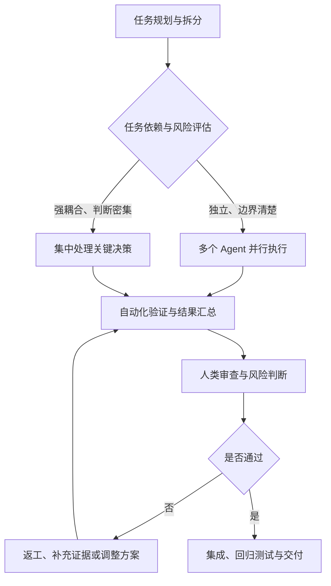

# The Orchestration Tax：多 Agent 协作的编排税

> 原文：[The Orchestration Tax — Addy Osmani](https://addyosmani.com/blog/orchestration-tax/)

## 一、核心观点

**启动更多 Agent，不等于获得更多生产力。** 多 Agent 并行执行可以加快代码生成，但审查、判断、协调和集成的速度并不一定同步提升。

**Orchestration Tax（编排税）** 指的是：当多个 Agent 并行工作时，人类为了理解它们的输出、判断结果是否正确、协调相互之间的修改，并将结果整合进项目而付出的额外认知成本。

例如，同时启动 10 个编码 Agent，它们也许能更快地产生代码，但人仍然需要判断这些代码是否正确、是否相互冲突、是否符合项目架构，以及是否值得合并。

> 核心问题不只是如何让 Agent 并行工作，还包括如何分配和保护人的注意力。

## 二、编排税从哪里来？

### 1. 生产代码容易并行，验证闭环不容易扩展

| 环节 | 典型工作 | 并行化特征 |
|---|---|---|
| 任务启动 | 分配任务、提供提示词 | 容易并行 |
| 执行 | 阅读代码、编写功能、补充测试 | 在任务相互独立时容易并行 |
| 验证 | 检查正确性、覆盖范围和边界条件 | 可自动化一部分，仍需判断 |
| 架构决策 | 处理跨模块约束、设计取舍 | 通常需要整体上下文 |
| 集成 | 解决冲突、统一接口、回归测试 | 受任务依赖关系影响 |
| 最终负责 | 确认质量、安全性和可交付性 | 不能仅凭 Agent 自述完成 |

如果 Agent 产生结果的速度超过审查和集成的速度，待处理队列就会不断累积。瓶颈会从“写代码”转移到“判断代码是否值得接受”。

```text
Agent A ──┐
Agent B ──┤
Agent C ──┼──> 待审查、待决策、待集成的结果
Agent D ──┤                       │
Agent E ──┘                       ▼
                           人类判断与整合
                                  │
                                  ▼
                             可交付的软件
```

### 2. 人类注意力是有限的共享资源

多个 Agent 可以同时运行，但多个任务一旦需要人类深度判断，就会竞争同一份注意力。人需要理解任务目标、已有实现、未解决问题、风险以及它与其他任务的关系。

这可以类比为多 Agent 系统中的一个串行瓶颈：并行执行能力不断增加，但关键判断并不会自动同比扩容。

#### GIL 类比

CPython 的 GIL（全局解释器锁）可以作为一个类比：多个线程在某些执行场景中不能同时执行 Python 字节码。类似地，多个 Agent 虽能同时产出结果，但它们可能需要同一个人来完成关键判断。

这只是架构类比，并不意味着人脑存在真正的“全局解释器锁”。

#### 阿姆达尔定律（Amdahl's Law）

阿姆达尔定律说明：只要系统仍有必须串行执行的部分，增加并行执行单元所带来的整体加速就会受到限制。

\[
S(N)=\frac{1}{s+\frac{1-s}{N}}
\]

其中：

- `N`：并行执行单元的数量。
- `s`：必须串行执行的工作占比。
- `S(N)`：理论加速比。

映射到 Agent 工作流：代码编写可能并行，但架构取舍、复杂审查和最终验收仍可能成为串行环节。若这些环节成为瓶颈，继续增加 Agent 的边际收益就会下降。

### 3. 上下文切换产生隐性成本

在不同 Agent 之间来回切换，需要反复重建对各个任务的理解：目标是什么、已经改了什么、当前状态如何、还有什么风险、是否影响其他模块。

过多的切换可能带来：

- 时间浪费在重新进入上下文，而非解决问题；
- 认知疲劳，难以持续进行深度判断；
- 审查变得浅层化，容易忽略边界条件或架构问题；
- 开发者逐渐不了解系统的实际状态。

最后一种问题可以称为**认知债务（Cognitive Debt）**：代码持续增加，但维护者对系统为什么这样实现、当前有哪些隐患的理解却在下降。

## 三、应对编排税的策略

### 1. 按照审查能力控制并发规模

不要只看工具允许启动多少个 Agent，而要考虑人和自动化流程能够处理多少结果。

- 独立、低风险任务可以提高并行度。
- 涉及安全、架构或共享模块的任务应谨慎增加并发。
- 当待审查结果持续积压时，应限制新任务或降低生产速率。

这与分布式系统的 **Backpressure（反压）** 思想一致：当下游处理能力不足时，上游应减速，避免队列无限增长。

```text
Agent 生成结果（生产者）
          │
          ▼
      待审查队列
          │
          ▼
审查、验证与决策（消费者）
          │
          ▼
       合并与交付

原则：生产速率应与下游可处理速率相匹配。
```

### 2. 区分可委派任务与判断密集型任务

| 类型 | 典型任务 | 建议 |
|---|---|---|
| 相对独立的任务 | 文档生成、独立模块实现、明确范围的测试补充 | 适合委派给后台 Agent 并行处理 |
| 强依赖整体上下文的任务 | 跨模块重构、复杂 Bug、架构设计、安全决策 | 尽量集中精力处理，避免强行并行 |

判断标准并非任务表面上是否复杂，而是它能否被拆分成边界清楚、依赖较少、结果可独立验证的工作单元。

### 3. 批量审查，减少频繁切换

与其每当一个 Agent 产生结果就立即切换过去，不如在适合的任务中让它们后台执行，再集中检查一批结果。

```text
启动多个独立任务
       ↓
Agent 后台执行
       ↓
汇总待审查结果
       ↓
集中查看差异、测试与实现摘要
       ↓
统一决策、修改与合并
```

批量审查的目标是减少低价值切换、保持思考连续性；但对高风险故障或安全问题，仍需要及时介入，不能为了批处理而延误必要的检查。

### 4. 用自动化证据降低审查成本

让 Agent 不只报告“已完成”，还应提供便于独立核验的证据，例如：

- 自动化测试及运行结果；
- 类型检查、Lint 和构建结果；
- 关键代码差异与实现摘要；
- UI 改动的截图或测试记录；
- 未解决的问题、假设与风险。

机器适合承担重复且可明确判定的检查，人则集中处理测试难以回答的问题，例如需求是否理解正确、设计是否合理、是否遗漏重要场景。

**测试通过不等于实现必然正确。** 自动化验证能降低审查成本，但不能完全替代对需求、架构和风险的判断。

### 5. 保护连续的深度思考时间

编排 Agent 本身不是最终目标，真正的目标是解决问题并交付可靠的软件。对于架构设计、疑难 Bug 或关键安全决策，暂停任务切换、集中思考，可能比继续启动 Agent 更有效。

## 四、放到 Agent Harness 架构中理解

从 Agent Harness Engineering 的角度看，不能只优化“如何调用 Agent”，还要设计任务、验证和人类审查之间的工作流。



以下是从文章观点推导出的工程设计方向，并不表示原文逐项定义了这套架构：

| Harness 机制 | 目的 |
|---|---|
| 任务拆分与依赖管理 | 避免把强耦合工作强行并行化 |
| 并发限制与反压 | 避免产出速度超过验证和集成速度 |
| 自动化验证 | 减少人工重复检查 |
| 结果汇总 | 降低切换多个 Agent 的上下文成本 |
| 状态与证据记录 | 让人快速理解进度、结果和失败原因 |
| 风险分级与人工审批 | 把有限的注意力用于高风险环节 |

### 一个实用的设计准则

可以把多 Agent 工作流看成一条流水线：

**任务拆分 → 并行执行 → 自动验证 → 人类判断 → 集成与交付**

每个环节都应有明确输入、输出和通过条件。特别是 Agent 交付给审查者的内容，应尽量包含变更摘要、验证证据和未解决风险，而不是仅给出自然语言的“任务已完成”。

## 五、关键概念对照

| 概念 | 含义 | 与编排税的联系 |
|---|---|---|
| Orchestration Tax | 多 Agent 协作带来的额外协调与认知成本 | 本文核心概念 |
| Amdahl's Law | 串行部分限制并行系统的整体加速 | 解释增加 Agent 的收益为何有限 |
| GIL（类比） | 某些 Python 执行场景下的并发限制 | 类比多个 Agent 争用人的判断能力 |
| Context Switching | 在不同任务间切换注意力 | 导致时间和认知负担增加 |
| Cognitive Debt | 系统复杂度增加，而人对系统的理解下降 | 过度委派和浅层审查的潜在后果 |
| Backpressure | 下游处理不过来时限制上游生产速率 | 控制任务积压与并发规模 |
| Automated Verification | 用测试、构建和静态检查核验结果 | 减少但不能消除人工审查成本 |

## 六、结论与启示

1. **Agent 数量不是生产力指标。** 运行中的任务越多，不代表可靠交付的软件越多。
2. **并行执行必须匹配验证能力。** 整体吞吐量受瓶颈环节限制，而不只取决于 Agent 的执行速度。
3. **人的注意力也属于系统资源。** 上下文切换、审查和关键决策都需要纳入工作流设计。
4. **自动化应提供证据，而不只是状态。** 测试结果、代码差异和风险摘要能够提高审查效率。
5. **最终目标是可靠交付，而不是最大化并发。** 好的 Harness 不仅让 Agent 产出更多结果，还要让这些结果能够被有效验证、理解和集成。

### 一句话总结

> 多 Agent 协作的关键，不是让尽可能多的 Agent 同时工作，而是提高每单位人类注意力能够验证、决策并交付的有效工作量。

## 延伸思考

- [ ] 当前工作流的真正瓶颈是代码生成，还是审查、验证与集成？
- [ ] Agent 的交付结果是否包含可独立检查的验证证据？
- [ ] 哪些任务可以安全并行，哪些任务需要共享上下文与集中判断？
- [ ] 是否需要限制并发数，或在待审查队列积压时实施反压？
- [ ] 自动化是否能把人类审查从重复检查转向需求、架构和风险判断？

---

## 来源

- Addy Osmani, [The Orchestration Tax](https://addyosmani.com/blog/orchestration-tax/)
