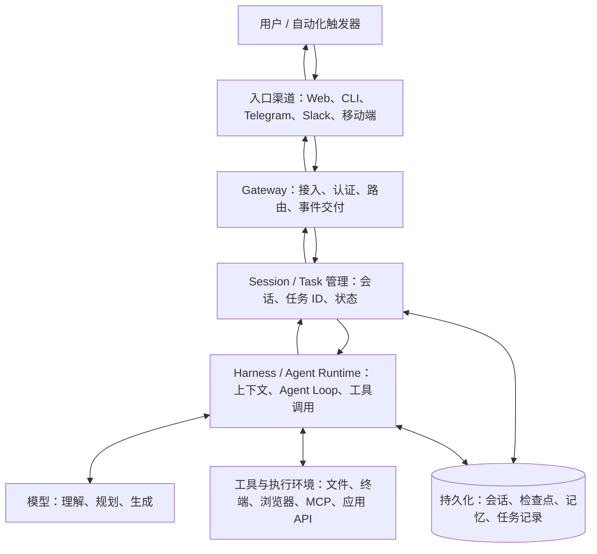
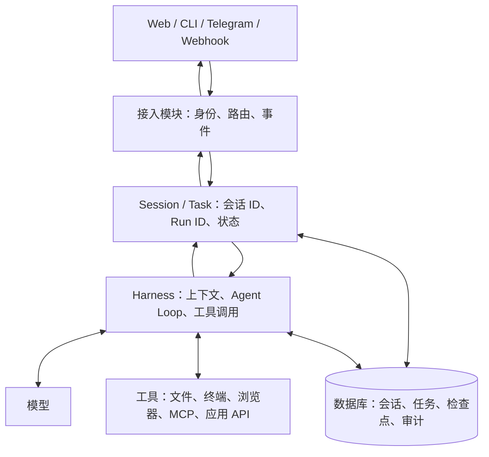

# Personal Agent、Gateway 与 Harness：架构辨析

> [!summary] 核心结论
> - **Personal Agent（PA）是产品方向**：Agent 不只完成一次性任务，而是长期围绕一个人的目标、偏好、数据和应用工作。
> - **Gateway 是接入与控制层**：统一处理请求入口、连接、身份、路由和事件交付。
> - **Harness 是 Agent 执行框架**：组织上下文、调用模型和工具、推进 Agent Loop，并管理执行过程。
> - Gateway 与 Harness 有职责重叠，但不是同义词；它们可以分进程部署，也可以在同一进程中实现。
> - **不是所有 Agent 都需要独立 Gateway**。当系统需要多入口、长期运行、远程访问、多 Agent 或统一权限管理时，Gateway 类能力才更有价值。

## 1. Personal Agent 是什么？

Personal Agent（个人智能体）不是一种新的模型类型，也不是严格的技术标准，而是强调**长期服务个人**的 Agent 产品形态。它希望持续了解用户的目标、偏好和工作上下文，并在授权范围内跨应用完成任务。

| 形态 | 主要目标 | 典型行为 |
|---|---|---|
| Chatbot / AI 助手 | 回答当前问题 | 解释概念、总结文章、回答咨询 |
| Task Agent / Coding Agent | 完成一个明确任务 | 读取仓库、调用工具、修改代码、运行测试 |
| Personal Agent | 长期协助个人处理连续事务 | 记住项目背景、跟进任务、管理资料、定时汇报、跨应用操作 |

这是一种便于理解的产品形态划分，不是严格的技术分代。Coding Agent 也可以有长期记忆或后台任务；Personal Agent 也可以写代码。

### 1.1 为什么 Personal Agent 受到关注？

1. **争夺新的软件入口**：用户表达目标，由 Agent 跨应用协调操作，而不是自己逐个打开应用。
2. **从回答转向执行**：价值不仅是生成建议，还包括持续完成任务、回报状态、处理失败。
3. **上下文长期积累**：偏好、历史项目、记忆、Skills 和工作流程可以跨会话复用。
4. **平台生态竞争**：模型厂商和应用平台会竞争连接器、用户上下文、授权能力与用户信任。

OpenAI 的 **dot** 与 xAI 的 **Grok Bot** 都体现了这一产品方向：前者强调全天候工作、融入工作流和权限控制；后者强调长期运行的 Bot、独立的云端计算环境以及多个 Bot 协作。它们是具体产品，不代表所有 Personal Agent 都采用相同的内部架构。

## 2. Agent 系统的逻辑分层

可以用下面这张图建立整体心智模型：



> [!note] 这是一张逻辑架构图，不要求系统必须拆成这么多独立服务。小型应用可以把 Gateway、Session 管理和 Harness 放在一个进程中。

## 3. Gateway 是什么？

Gateway 在这里指 **Agent Gateway**：Agent 系统的统一接入与控制入口。它可能是一个长期运行的服务，也可能只是应用后端中的一组模块。

“Gateway”在不同语境下并不完全相同：

| 名称 | 主要解决的问题 |
|---|---|
| 网络网关 | 不同网络之间的数据包转发 |
| API Gateway | API 的统一入口、鉴权、路由、限流等 |
| Agent Gateway | Agent 的消息渠道、客户端、设备或控制接口如何统一连接和管理 |

Agent Gateway 与 API Gateway 有交集，但 Agent 场景还可能需要管理持续连接、Agent/Session 路由、运行事件、设备配对、审批和任务状态。

### 3.1 Gateway 常见职责

- **多入口接入**：接入 Web UI、CLI、聊天平台、Webhook、移动端等。
- **身份与连接管理**：认证客户端、识别设备、管理连接生命周期。
- **请求路由**：决定请求发给哪个 Agent、会话或运行实例。
- **协议与控制接口**：向 UI/CLI 暴露统一 API 或 JSON-RPC/WebSocket 接口。
- **事件与结果交付**：推送运行状态、进度、审批请求和最终结果。
- **安全边界**：处理连接级权限；更细粒度的工具权限通常还需要 Harness 或执行层配合。
- **可选的后台能力**：一些产品还会在 Gateway 周边整合定时任务、通知或生命周期管理，但这些并非 Gateway 的必备功能。

### 3.2 Gateway 不一定负责什么？

Gateway 通常不需要决定复杂任务的推理策略，也不应该负责全部工具执行细节。比如“先检索哪三个项目、如何比较架构、搜索结果不足时是否继续”，这主要属于 Harness 的执行逻辑。

## 4. Harness 是什么？

Harness（Agent Harness / Agent Runtime）是围绕模型构建的运行框架，使模型能够通过工具和状态完成任务，而不只是生成一段回答。

常见职责包括：

- 构造模型输入：系统指令、上下文、会话历史、Skills、检索结果。
- 运行 Agent Loop：模型输出 → 解析工具调用 → 执行工具 → 回填结果 → 再次调用模型。
- 管理工具与权限：注册工具、验证参数、执行工具、处理审批与沙箱。
- 管理执行状态：当前步骤、工具结果、重试、终止条件和部分恢复机制。
- 质量控制：校验输出、处理异常、限制循环与成本。

简化的 Agent Loop：

```text
接收任务
  ↓
构造上下文并请求模型
  ↓
模型给出最终回答？── 是 → 返回结果
  │ 否
  ↓
解析工具调用 → 权限检查 → 执行工具
  ↓
把工具结果写回上下文
  └──────────────→ 再次请求模型
```

Harness 的边界也不是固定的：有些实现会把会话存储、任务恢复、子 Agent 编排等放进来；有些会把这些功能交给独立服务。

## 5. Gateway 与 Harness 的区别和重叠

### 5.1 核心区别

| 维度 | Gateway | Harness |
|---|---|---|
| 核心问题 | 请求如何进入、连接和分发？ | Agent 如何思考、调用工具并完成任务？ |
| 主要对象 | 客户端、渠道、身份、会话路由、事件 | 模型上下文、工具、执行步骤、任务结果 |
| 典型动作 | 接收消息、鉴权、路由、推送事件 | 规划步骤、生成工具调用、处理结果、继续循环 |
| 典型故障 | 连接失败、认证失败、路由错误、事件丢失 | 工具失败、推理跑偏、循环不终止、任务失败 |

### 5.2 三个常见的重叠区

1. **Session 与状态**：Gateway 需要定位会话；Harness 需要会话历史和执行上下文。两者可以共享存储，但关注点不同。
2. **工具调用路由**：Harness 决定调用哪个工具；Gateway 或其他路由层可能负责把请求送到目标服务。两者不矛盾。
3. **任务生命周期**：Gateway 可能负责接收任务、通知状态；Harness 负责推进执行。持久化、重试和恢复可能由任务服务、运行时或调度器共同承担。

> [!tip] 判断一个功能属于哪里，不要只看目录名，而要看它解决的问题：
> - “请求如何进入、认证、分发和交付？”——偏 Gateway。
> - “模型下一步做什么，怎样调用工具，何时结束？”——偏 Harness。

## 6. 主流项目中的相似结构

并不是只有名为 `Gateway` 的目录才有类似能力。很多项目提供的是 App Server、SDK、RPC 或 Agent Server，覆盖 Gateway 的部分职责，但未必承担多聊天渠道接入。

| 项目 | 类似 Gateway 的结构 | 主要侧重点 | 不是完全等价于什么 |
|---|---|---|---|
| [OpenClaw](https://github.com/openclaw/openclaw) | 独立、长期运行的 Gateway 服务 | 多聊天渠道、控制客户端、设备节点、WebSocket 控制面、认证与事件 | 不只是一个反向代理；它也不等于整个 Harness |
| [Hermes Agent](https://github.com/NousResearch/hermes-agent) | Messaging Gateway | 多平台消息适配、会话路由、消息投递、配对授权 | 侧重消息渠道，不应把 Gateway 与 Agent 执行逻辑混为一谈 |
| [Codex App Server](https://developers.openai.com/codex/app-server) | App Server + JSON-RPC 接口 | 让多种客户端以统一协议控制 Codex、读取状态和接收事件 | 默认传输是 stdio；WebSocket 支持有实验性/受限说明，因此不应简单等同于公开部署的通用 Gateway |
| [Pi](https://github.com/earendil-works/pi) | SDK / RPC Mode | 在其他程序中嵌入 Pi，或用 JSONL 子进程协议长期双向控制它 | RPC 是进程控制接口，不是自带多聊天平台接入的 Gateway |
| [Claude Code](https://code.claude.com/docs/en/remote-control) | Remote Control + Agent SDK | 远程继续操作本地会话；在自有应用中编程式使用 Agent Loop | Remote Control 不是通用的、自托管的多渠道 Gateway |
| [LangGraph](https://github.com/langchain-ai/langgraph) | LangGraph Server / Agent Protocol 相关 API | Runs、Threads、状态、流式事件、检查点和恢复 | 更偏 Agent 执行服务与任务 API，不是以聊天平台为中心的消息 Gateway |
| [Dify](https://github.com/langgenius/dify) | 应用后端与 API 服务 | 将 Agent、工作流和知识库能力服务化，对外提供业务 API | 更偏 AI 应用开发平台 |
| [Letta](https://github.com/letta-ai/letta) | Agent Server / 应用接口 | 有状态 Agent、记忆与持续对话 | 侧重点在状态化 Agent 与记忆，不是典型消息 Gateway |

### 6.1 如何理解 Codex、Pi、Claude Code 为什么不一定单独设置 Gateway？

它们并不是“没有任何类似能力”，而是产品边界不同：

- **Codex**：App Server 提供客户端和 Harness 之间的统一控制接口，但其目标不同于 OpenClaw 的多聊天渠道网关。
- **Pi**：更强调精简、可扩展的 Harness。SDK/RPC 允许上层产品自行决定要不要提供 Gateway。
- **Claude Code**：CLI、Remote Control 和 Agent SDK 覆盖本地执行、远程访问、程序化集成等不同场景，不需要把它们都收敛成一个对外的独立消息网关。

因此，项目没有独立 `Gateway` 组件，不等于没有 API、远程连接或会话管理。应当检查它实际提供的服务边界和协议。

## 7. 为什么 Personal Agent 更容易需要 Gateway？

典型 Coding Agent 往往是“用户打开终端或 IDE → 启动一个 Agent → 在本地仓库完成任务”。客户端可以直接启动 Harness 或调用 App Server，独立增加 Gateway 的收益有限。

Personal Agent 往往是“多个入口 → 同一个长期运行的 Agent → 访问多种应用 → 后台继续执行 → 结果再通知用户”。它自然需要更统一的接入与控制机制。

| 使用场景 | 是否需要独立 Gateway？ | 理由 |
|---|---|---|
| 本地 CLI，单用户、单入口、短任务 | 通常不需要 | CLI 可以直接调用 Harness |
| 单一桌面 UI + 本地 Agent | 不一定 | 同进程或本地 RPC 通常足够 |
| Web、CLI、Telegram 等入口共享同一 Agent | 值得考虑 | 需要统一身份、会话路由和结果投递 |
| 后台 24/7 任务、事件触发、完成后通知 | 通常需要类似的接入/控制层 | 客户端生命周期与 Agent 生命周期分离 |
| 多 Agent、多设备、跨应用的 Personal Agent | 强烈建议明确设计 | 需要统一路由、权限、任务状态与审计 |
| 多用户企业 Agent 平台 | 通常需要 | 需要租户隔离、认证授权、配额、审计与服务治理 |

“需要 Gateway 类能力”不代表必须把它部署成独立进程。早期可以先在一个后端应用里实现清晰的模块边界，规模或隔离需求增加时再拆分。

## 8. 建议的最小架构

如果用 Pi 或 Codex 作为执行内核，开发一个能从 Web、CLI 和 Telegram 接收任务的个人 Agent，可以先按逻辑分层，而不是一开始就微服务化：



### 推荐的职责边界

- **Gateway / 接入模块**：认证、渠道适配、请求校验、Agent/Session 路由、事件推送。
- **Session / Task 管理**：任务 ID、会话关联、任务状态、幂等键、恢复信息。
- **Harness**：Prompt/Context、Agent Loop、工具调用、执行权限、终止条件。
- **工具与执行环境**：MCP Server、应用连接器、浏览器、终端和文件系统。
- **持久化层**：会话历史、任务状态、检查点、记忆和审计记录。

### 开发顺序

1. 先实现单入口 Agent：Harness + 工具调用 + 会话记录。
2. 增加统一的请求接口、Session ID、Run ID 和结构化状态事件。
3. 接入第二种客户端或聊天渠道，验证路由、身份和消息投递需求。
4. 当需要长期运行时，再加任务队列、调度、重试、检查点和通知。
5. 最后强化设备配对、权限分级、审计与租户隔离。

> [!warning] 不要一开始就把 Gateway 做成另一个 Agent。Gateway 主要负责接入、路由和交付；规划和工具执行应由 Harness 负责。需要多 Agent 任务分解时，再引入独立的编排层。

## 9. Gateway 与周边概念的区别

| 概念 | 主要解决什么问题 | 与 Gateway 的关系 |
|---|---|---|
| Harness | Agent 怎样推理、调用工具和完成任务 | Gateway 可把任务交给 Harness |
| API Gateway | API 的统一入口、鉴权、路由、限流 | Agent Gateway 可复用 API Gateway 的部分模式 |
| MCP | 模型应用如何通过统一协议使用工具、资源或提示 | Gateway 可以调用或管理 MCP 相关服务，但两者不是同一层 |
| A2A | Agent 与 Agent 之间如何交换任务与结果 | Gateway 可以作为接入点，但不等于 A2A 协议或编排器 |
| WebSocket | 持续双向通信的传输协议 | Gateway 可以使用 WebSocket；它不是 Gateway 本身 |
| Session / Thread | 将多轮交互或状态归属于一个会话 | Gateway 可路由 Session；Harness/Server 可能负责实际状态与执行上下文 |
| Orchestrator | 拆分任务、选择 Agent、管理依赖与协作 | 可独立于 Gateway；也可能与其部署在同一服务里 |

## 10. 参考项目与学习路线

建议按以下顺序阅读：

1. **OpenClaw Gateway Architecture**：先看完整控制面、客户端和设备节点的关系。
2. **OpenClaw Gateway Protocol**：看握手、请求/响应、事件、权限范围和协议校验。
3. **Hermes Gateway Internals**：看多聊天平台适配、SessionStore、消息投递和配对授权。
4. **Pi RPC Mode / SDK**：看怎样把一个 Harness 暴露给其他进程或应用控制。
5. **Codex App Server**：看 JSON-RPC、客户端能力发现、任务控制与事件推送。
6. **LangGraph / Agent Protocol**：看 Runs、Threads、Store、流式事件和持久化执行状态。
7. **Claude Code Remote Control / Agent SDK**：对照“远程控制已有本地会话”和“把 Agent 嵌入自有应用”这两种不同集成形态。

## 11. 官方参考链接

- [OpenClaw — Gateway architecture](https://github.com/openclaw/openclaw/blob/main/docs/concepts/architecture.md)
- [OpenClaw — Gateway protocol](https://github.com/openclaw/openclaw/blob/main/docs/gateway/protocol.md)
- [Hermes Agent — Gateway Internals](https://github.com/NousResearch/hermes-agent/blob/main/website/docs/developer-guide/gateway-internals.md)
- [Hermes Agent — Architecture](https://github.com/NousResearch/hermes-agent/blob/main/website/docs/developer-guide/architecture.md)
- [Codex — App Server](https://developers.openai.com/codex/app-server)
- [Pi — RPC Mode](https://github.com/earendil-works/pi/blob/main/packages/coding-agent/docs/rpc.md)
- [Pi — SDK](https://github.com/earendil-works/pi/blob/main/packages/coding-agent/docs/sdk.md)
- [Claude Code — Remote Control](https://code.claude.com/docs/en/remote-control)
- [Claude Agent SDK overview](https://code.claude.com/docs/en/agent-sdk/overview)
- [LangGraph](https://github.com/langchain-ai/langgraph)
- [LangChain Agent Protocol](https://github.com/langchain-ai/agent-protocol)
- [Dify](https://github.com/langgenius/dify)
- [Letta](https://github.com/letta-ai/letta)
- [OpenAI — Introducing dot](https://openai.com/zh-Hans-CN/index/introducing-dots/)
- [xAI — Introducing Grok Bot](https://x.ai/news/introducing-grok-bot)

---

## 一句话总结

**Personal Agent 是产品目标；Harness 负责执行 Agent；Gateway 负责把 Agent 作为长期服务连接、控制和交付出去。** 是否拆出 Gateway，取决于系统是否需要多入口、持久运行、远程控制、统一权限和跨应用协作，而不是取决于项目是否叫“Agent”。
