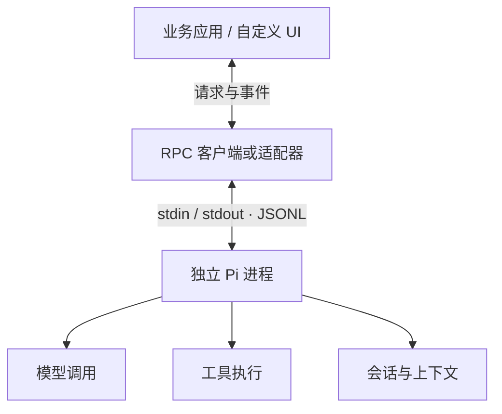
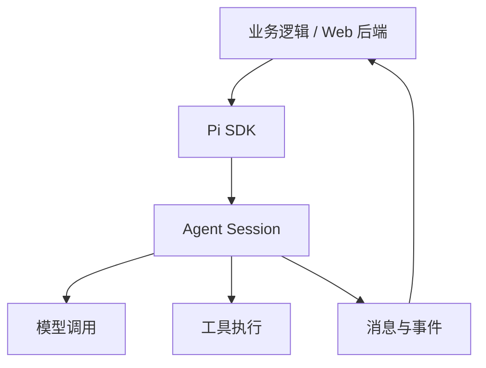
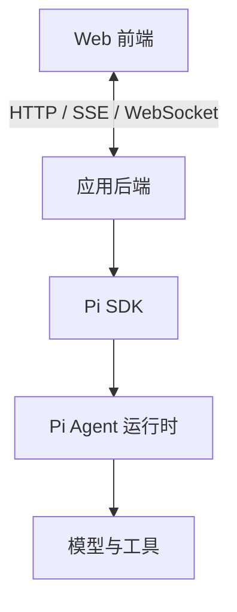
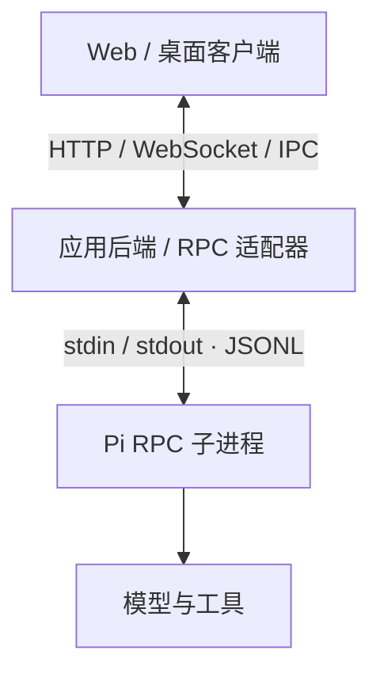
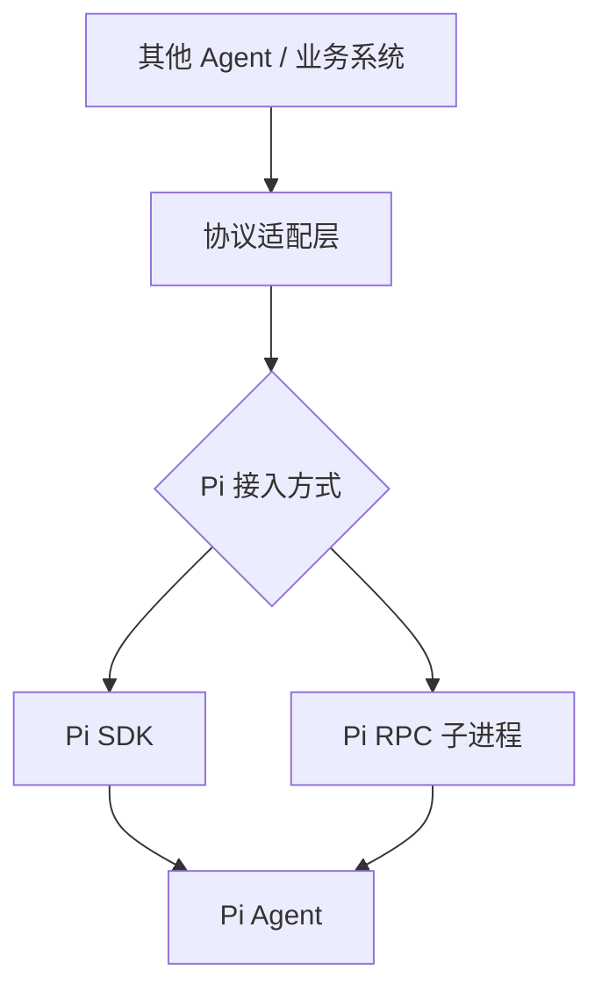

# Pi Agent 封装方式全景梳理

> [!abstract] 核心结论
> 开发自己的 Agent，可以把 Pi 当作完整的 Agent 应用来嵌入，也可以将它作为独立进程调用，或者只复用底层组件、自己搭建 Harness。  
> **SDK、RPC、Server/Client、插件扩展和底层包复用并不是同一层级、互斥的选项。** 其中 SDK/RPC 属于接入运行时的方式；Server/Client 属于应用架构；Extension/Skill 属于扩展机制；复用底层包或 Fork 属于代码复用与定制策略。

## 1. 先建立正确的分类框架

讨论“封装 Pi”时，建议先分清下面几个维度：

| 维度 | 核心问题 | 典型方案 |
|---|---|---|
| 运行入口 | 如何启动、驱动 Pi？ | Interactive、Print、JSON、RPC、SDK |
| 应用架构 | 前后端如何连接？ | Web Server/Client、桌面 IPC、后台 Worker |
| 扩展机制 | 如何增加功能而不改核心？ | Extension、Skill、Prompt Template、Theme、Package |
| 代码复用层级 | 复用完整 Agent 还是底层模块？ | `pi-coding-agent` SDK、`pi-agent-core`、`pi-ai` 等 |
| 定制深度 | 是否需要修改内部实现？ | 配置与扩展、组合底层包、Fork 源码 |
| 对外协议 | 如何让其他系统调用 Pi？ | 自建 HTTP API、MCP Server、A2A 适配器等 |

这些维度可以组合。例如：

- **Web 应用**可以采用“Web Server + Pi SDK”，也可以采用“Web Server + Pi RPC 子进程”。
- **桌面应用**可以在主进程中嵌入 SDK，也可以启动独立 RPC 子进程，还可以通过 PTY 展示 Pi 的终端界面。
- **其他语言的服务**可以通过 RPC 调用 Pi，也可以把 Pi 包装成 HTTP 服务供其他系统使用。
- **自建 Harness**可以复用 `pi-agent-core` 和 `pi-ai`，再自行实现业务层、上下文策略、持久化和 UI。

## 2. Pi 的常见运行入口

官方 CLI 集成文档重点介绍了多种运行入口。它们的交互能力与生命周期并不相同。

| 入口 | 工作方式 | 适合场景 | 主要限制 |
|---|---|---|---|
| Interactive / TUI | 以交互式终端界面运行 Pi | 直接使用 Pi；保留终端交互体验 | 不适合直接提供完全自定义的图形界面 |
| Print | 启动 CLI，完成单次任务并输出最终结果 | Shell 脚本、批处理、定时任务、一次性自动化 | 不以持续交互和完整事件流为主要用途 |
| JSON | 执行任务并输出 JSONL 事件流 | 记录轨迹、展示执行进度、消费事件 | 通常是一次性进程；不等于可持续发送命令的 RPC |
| RPC | Pi 进程持续运行，通过 stdin/stdout 的 JSONL 协议收发命令、响应和事件 | 跨语言接入、自定义 UI、进程隔离 | 需要维护进程生命周期、协议解析和事件映射 |
| SDK | 在 TypeScript / JavaScript 运行环境中直接调用 Pi 的 API | Web 后端、桌面应用、需要深度控制的同语言应用 | 与具体运行时和包版本耦合；需自己管理应用层 API 与权限 |

参考：

- [Pi CLI Integration](https://pi.dev/docs/latest/cli-integration)
- [Pi SDK](https://pi.dev/docs/latest/sdk)

### 2.1 Print、JSON 和 RPC 的差别

这三种模式容易混淆：

- **Print：**主要关心一次执行的最终答案。
- **JSON：**主要关心一次执行期间持续产生的结构化事件。
- **RPC：**主要关心与一个持续运行的 Pi 实例双向交互，能够在会话生命周期内继续发送控制命令。

因此，不能把 JSON 事件流直接等同于 RPC。JSONL 只是数据序列化格式之一；真正决定交互能力的是进程生命周期和协议语义。

> [!important]
> Pi 的 RPC 通过标准输入和标准输出通信，**不意味着它天然就是 HTTP Server**。如需浏览器访问，通常还要编写适配层，将 RPC 请求和事件转换为 HTTP、SSE 或 WebSocket 消息。

## 3. 十类 Pi 封装与复用方式

### 方式 1：直接运行 CLI，或将 TUI 嵌入终端

直接启动 Pi 的交互式终端界面；桌面应用也可通过 PTY（伪终端）在自己的窗口中展示它。

**适合：**希望快速得到可用 Agent、保留 Pi 原生 TUI、优先验证工作流。

**优点：**集成工作少，可继续沿用 Pi 原有交互体验。

**限制：**如果要做完全自定义的聊天 UI、工具调用面板、任务树或工作区，需要额外处理终端交互，或者转向 SDK/RPC。

### 方式 2：Print 模式单次调用

主程序把任务交给 Pi CLI，等待进程完成，再读取最终结果。

**适合：**脚本自动化、定时任务、批量代码审查、单次分析任务。

**优点：**调用模型与工具的流程可以交给 Pi，应用端只需负责输入、输出和任务调度。

**限制：**不适合需要长期会话、持续控制或细粒度实时 UI 的场景。

### 方式 3：JSON 事件流模式

启动 Pi 执行任务，并消费输出的 JSONL 事件。

**适合：**任务进度显示、执行轨迹收集、日志分析、自动化监控。

**优点：**相比只读取最终答案，应用能观察中间事件。

**限制：**不要把它当作支持持续双向控制的 RPC 服务；需要继续向同一实例发送命令时，应考虑 RPC 或 SDK。

### 方式 4：RPC 子进程模式

应用启动 Pi 的 RPC 模式，通过 `stdin/stdout` 收发 JSONL 命令、响应和事件。主程序可以使用任意语言，只要实现对应协议。

**适合：**Python、Go、Rust、Java 等其他语言接入；需要自定义 UI；希望把 Agent 与主应用分进程运行。

**优点：**语言无关、边界明确、便于独立重启和监控。

**成本：**应用要处理进程生命周期、消息关联、事件转发、错误恢复、超时和异常退出等问题。

### 方式 5：通过 SDK 嵌入 Pi

应用在自己的 TypeScript / JavaScript 进程里直接导入 Pi 的 SDK，创建会话、订阅事件并配置工具或模型。

**适合：**Web 后端、桌面主进程、需要自定义工具和会话行为的 TypeScript 应用。

**优点：**可直接使用程序 API，无须自行定义一套跨进程协议；便于管理会话、监听事件、注册自定义工具和资源加载逻辑。

**成本：**应用与 Pi 的运行时、依赖和 API 版本耦合更紧；需自己做好应用层的权限、生命周期和错误处理。

### 方式 6：自建 Server/Client 应用架构

Server/Client 不是 Pi 独有的运行模式，而是整个产品的架构选择。后端负责会话与任务管理，前端通过 HTTP、SSE、WebSocket 或桌面 IPC 通信。

可以在 Server 内直接使用 SDK，也可以让 Server 通过 RPC 控制独立 Pi 进程。

#### 架构 A：Server + SDK

**适合：**以 TypeScript 为主、需要深度控制会话和事件的 Web 产品。

后端通常负责：用户身份、授权、会话管理、任务队列、工作区权限、事件转换和审计日志。前端不应直接获得模型密钥或拥有操作系统权限的 Agent 控制权。

#### 架构 B：Server + RPC

**适合：**需要进程隔离、跨语言接入，或希望独立管理每个 Pi 进程的应用。

后端需要管理客户端、任务和 Pi 子进程之间的映射，并将 Pi 事件转换成前端协议。RPC 进程隔离本身不等于安全沙箱。

#### 桌面应用的三种常见路线

| 路线 | 适合情况 |
|---|---|
| 桌面主进程 + SDK + IPC | TypeScript 技术栈，希望主进程直接管理 Agent 会话 |
| 桌面主进程 + RPC 子进程 | 希望独立运行 Pi、控制进程边界，或主程序采用其他语言 |
| 桌面应用 + PTY | 主要目标是嵌入和展示 Pi 的原生 TUI |

因此，“Server/Client 就是桌面端的 CS 架构”只说对了一部分：桌面端可以这样设计，但并非必须；Web 应用同样经常使用这种结构。

### 方式 7：Extension、Skill、Prompt Template、Theme 与 Package

如果目标只是增加能力，通常不需要把 Pi 整体包起来，更不一定要 Fork 源码。

- **Extension：**扩展或调整 Agent 行为，例如注册工具、处理事件、介入交互流程。
- **Skill：**向 Agent 提供可按需加载的任务知识、步骤和操作规范。
- **Prompt Template：**复用特定任务的提示词或工作流入口。
- **Theme：**调整 TUI 的视觉表现。
- **Package：**组织和分发扩展、技能及相关资源。

**适合：**保留 Pi 原有 Harness，仅增加工具、工作流、上下文处理、界面样式或任务规范。

参考：

- [Pi Documentation](https://pi.dev/docs/latest)
- [Pi SDK](https://pi.dev/docs/latest/sdk)

### 方式 8：复用底层包，自建 Harness

不直接使用完整的 `pi-coding-agent`，而是根据自身需要组合更底层的模块，自行定义 Agent Loop、上下文组织、工具调度、记忆与持久化策略。

| 组件方向 | 主要职责 | 可能的用途 |
|---|---|---|
| `pi-ai` | 模型调用与统一模型接口 | 复用模型提供商适配、请求和流式输出能力 |
| `pi-agent-core` | Agent 运行时基础设施 | 复用 Agent Loop、工具调用和状态流转相关能力 |
| `pi-coding-agent` | 较完整的 Coding Agent 应用 | 复用会话管理、编码工具和现成 Harness |
| `pi-tui` | 终端 UI 组件 | 自建 TUI，而不是从头实现终端渲染 |
| `pi-durable`、`chord` 等相关组件 | 持久化或应用运行时相关能力 | 在确有对应需求时单独评估，不应默认视为每个 Agent 都必需的依赖 |

> [!warning]
> 包名、导出 API、依赖关系和功能边界可能随 Pi 版本或发行组织变化。正式开发前应以当前仓库、`package.json`、API 文档和示例为准，不要只复制旧文章中的包名。

**适合：**需要改变 Harness 的核心策略，但又希望复用 Pi 已有的模型与 Agent 基础设施。

**代价：**你需要自己承担更多设计和维护工作，例如会话状态、上下文构建、工具策略、持久化、恢复、错误处理和评估。

### 方式 9：Fork Pi 源码并维护自己的发行版

基于 Pi 源码建立自己的分支，改造内部机制、默认配置、命令、UI 或运行时行为。

**适合：**必须修改公开扩展机制无法覆盖的核心行为，或希望完全控制发行版。

**优点：**自由度最高。

**代价：**必须自行跟进上游变化、解决合并冲突、维护兼容性与安全修复。

建议的升级阶梯是：

1. 先使用配置和现有功能；
2. 再使用 Extension、Skill、Package 等扩展能力；
3. 再考虑 SDK 或 RPC 集成；
4. 若确实不需要完整 Harness，再复用底层包自建；
5. 只有无法通过上述方式满足需求时，才 Fork 源码。

### 方式 10：在 Pi 外围增加协议适配层

如果目标是让其他 Agent 或系统调用 Pi，可以在外围实现适配器，而不一定直接开发用户交互界面。

例如：

- **HTTP API：**将任务提交、会话管理和结果查询开放给其他业务系统。
- **MCP Server：**把 Pi 包装成其他 Agent 可以调用的工具或服务。
- **A2A 适配器：**把 Pi 的任务生命周期、状态和结果映射到 Agent 间协作协议。

这类适配器属于你自己的外围服务，不应假设 Pi 的 RPC 自动兼容 MCP、A2A 或 HTTP。还需要设计工具输入输出 Schema、身份验证、错误映射、取消机制、权限边界和任务状态语义。

## 4. SDK、RPC、Server/Client 到底是什么关系？

| 概念 | 属于什么层级？ | 回答的问题 | 可以组合吗？ |
|---|---|---|---|
| SDK | 程序 API / 进程内集成方式 | 如何在代码中调用 Pi？ | 可以与 Server/Client 组合 |
| RPC | 跨进程通信协议 / 运行入口 | 如何持续控制独立 Pi 进程？ | 可以由 Server 管理，再对外提供 HTTP API |
| Server/Client | 应用架构 | 前端和后端如何分工及通信？ | 可以选 SDK 或 RPC 作为后端接入方式 |
| HTTP / SSE / WebSocket | 客户端与应用服务之间的通信机制 | 如何传递请求、事件和流式结果？ | 可用于 SDK 后端，也可用于 RPC 适配后端 |
| Extension / Skill | 扩展机制 | 如何给 Pi 增加能力或知识？ | 可与 SDK、RPC、CLI 等方式共同使用 |
| 复用底层包 | 代码复用策略 | 是否要自己构建 Harness？ | 可与自建 Server、CLI 或 UI 组合 |
| Fork | 源码定制策略 | 是否要维护自己的核心实现？ | Fork 后仍可以提供 SDK、CLI 或服务接口 |

**关键点：不要把不同抽象层级的概念放在一个互斥选项列表里。** SDK 和 RPC 主要回答“应用如何接入 Pi”；Server/Client 回答“产品整体如何拆分”；Extension 回答“如何扩展能力”；Fork 回答“要不要维护自己的代码分支”。

## 5. 如何选择：决策表

| 需求 | 建议起点 | 主要原因 |
|---|---|---|
| Web Agent，需要自定义聊天 UI、实时工具事件和会话管理 | SDK + Web 后端 | 同语言集成方便，易于管理会话和事件 |
| Web Agent，但需要把 Pi 放在独立进程中 | RPC + 服务端适配层 | 进程边界清楚，后端可以统一管理客户端与子进程 |
| Electron / Tauri 桌面应用，主要使用 TypeScript | SDK + 桌面主进程 + IPC | 集成路径直接，适合由主进程管理会话和权限 |
| 桌面应用，主程序使用其他语言或需要分离进程 | RPC 子进程 | 通过协议建立语言和进程边界 |
| 想直接嵌入 Pi 原生终端界面 | PTY + TUI | 避免重做完整图形 UI |
| Python / Go / Rust / Java 等语言接入 | RPC | 通常比直接嵌入 TypeScript SDK 更自然 |
| 批量脚本或一次性任务 | Print | 只处理输入与最终输出即可 |
| 需要收集单次执行过程中的事件 | JSON 模式 | 通过 JSONL 消费过程事件 |
| 想增加工具、工作流或知识，但不想重写 Agent | Extension / Skill / Package | 保留现有 Harness，改造成本较小 |
| 想重写 Agent Loop、上下文和记忆策略 | 复用 `pi-agent-core`、`pi-ai` 等底层包 | 只保留真正需要的基础设施 |
| 公开给其他 Agent 调用 | 自建 MCP / A2A / HTTP 适配层 | 将内部能力映射到目标协议的语义 |
| 必须修改扩展机制覆盖不到的核心行为 | 最后再考虑 Fork | 只有这时维护分支的代价才可能合理 |

## 6. 推荐的工程路径

如果目标是开发一个完整的个人 Agent 产品，而不是单纯运行 Pi，可以按以下次序推进：

1. **先用完整 `pi-coding-agent` SDK 建立最小应用。** 做出会话创建、消息发送、流式事件和工具调用的闭环。
2. **设计业务层边界。** 把用户、工作区、会话、任务、权限、事件传输和持久化放在自己的应用层，不要让前端直接依赖 Pi 内部结构。
3. **根据部署要求决定是否转 RPC。** 如果需要跨语言或运行时隔离，将 Pi 放进独立进程，通过 RPC 适配器管理。
4. **先用扩展机制实现差异化功能。** 工具、Skill、Hooks、Prompt 和资源加载等需求，优先查找现有扩展入口。
5. **确有必要时才下沉到核心包。** 当默认 Harness 无法满足需求，再组合 `pi-agent-core`、`pi-ai` 等组件。
6. **最后才考虑 Fork。** 只有必须修改内部实现且无法通过公开接口达成时，再承担长期维护成本。

## 7. 安全与部署边界

> [!danger] RPC 或 SDK 本身都不等于安全沙箱
> RPC 只是通信边界；SDK 只是集成方式。它们不会自动限制 Agent 读写文件、执行命令或访问网络的权限。

构建 Web 或远程 Agent 时，至少需要明确：

- **身份与授权：**谁有权创建会话、调用工具、读取文件或中断任务。
- **工作区隔离：**每个用户或任务能访问哪些目录和资源。
- **工具权限：**Shell、文件系统、网络、数据库等能力是否需要审批或白名单。
- **进程与系统隔离：**是否使用容器、操作系统权限、专用用户或其他沙箱机制。
- **密钥管理：**模型提供商密钥和其他凭证不能暴露给浏览器或不可信工具。
- **任务生命周期：**取消、中断、超时、异常退出、重试和恢复如何处理。
- **审计与观测：**保存必要的执行事件，同时避免无必要地记录敏感数据。
- **并发管理：**明确每个会话由谁拥有、如何串行化操作，以及多个客户端能否同时控制同一会话。

## 8. 最终结论

原先提出的三种方式——RPC、Server/Client、SDK——**有参考价值，但并不完整，也不是三个互斥的并列方案**。

更准确的理解是：

- **RPC：**通过标准输入输出和 JSONL 协议，持续控制独立运行的 Pi 进程。
- **SDK：**在同一运行时中直接调用 Pi API，适合同语言深度集成。
- **Server/Client：**是一种整体应用架构，既可以建立在 SDK 上，也可以建立在 RPC 上。
- **CLI 的 Print / JSON / Interactive：**适合单次任务、事件观察和直接交互等不同需求。
- **Extension / Skill / Package：**适合以最小改动扩展现有 Pi。
- **底层包复用：**适合需要自己设计 Harness 的项目。
- **协议适配与 Fork：**分别用于跨 Agent / 系统集成，以及无法通过公开接口完成的深度定制。

**默认建议：先用 SDK 复用完整的 Pi Harness；有跨语言或进程隔离需求时选择 RPC；需要改变 Agent 核心控制流程时，再直接复用底层包。**

## 9. 官方资料

- [Pi Documentation](https://pi.dev/docs/latest)
- [CLI Integration](https://pi.dev/docs/latest/cli-integration)
- [SDK](https://pi.dev/docs/latest/sdk)

> [!note] 版本提示
> Pi 的项目结构、包名、SDK API 和 CLI 参数可能持续变化。开始实现前，请以官方文档和当前安装版本的源码为准，并用最小 Demo 验证关键 API。
