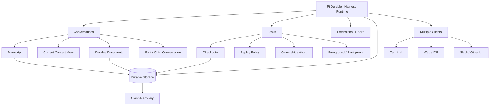

# Pi Durable：面向长期运行 Agent 的持久化 Harness

> [!abstract] 核心观点
> **Pi Durable 不是单纯增强 Pi Coding Agent，而是把 Agent 的运行、状态与任务管理抽象成可持久化的 Harness Runtime。** 它希望 Agent 在进程重启后能够恢复，支持多个 Conversation 并发运行、分叉、多人接入，以及动态更新能力。

来源：[Pi Durable | Earendil](https://earendil.com/posts/pi-durable/)

## 1. 一句话理解

- **Pi Coding Agent**：面向终端和个人开发者的 Coding Agent，重点是完成当前开发任务。
- **Pi Durable**：面向长期运行的 Agentic Application，重点是让 Conversation、Task 和应用状态能够持久化、恢复、并发与演进。

可以把它看作从 **Agent Loop** 向 **Durable Agent Runtime** 的扩展。

```text
传统 Agent：收到输入 → Agent Loop → 工具执行 → 返回结果

Durable Agent：
输入
  ↓
持久化的 Conversation
  ↓
可追踪的 Tasks / Checkpoints
  ↓
Durable Storage
  ↓
崩溃恢复、分叉、并发执行、多客户端接入
```

这里的“Durable”强调执行状态和历史可以持久化并用于恢复；“Malleable”强调运行中的 Agent 能力可以调整或更新。

## 2. 为什么需要 Pi Durable？

普通 Coding Agent 通常由一个用户通过终端驱动，运行在一个进程中。进程中断后，用户往往需要重新启动并手动恢复工作。

当 Agent 应用需要长期运行、由多个客户端接入，或同时处理多个任务时，仅有 Agent Loop 不够，还需要解决：

- **故障恢复**：进程中断后，识别哪些工作已完成、正在执行或尚未开始。
- **任务生命周期**：管理取消、重试、后台任务、子任务和清理操作。
- **状态一致性**：让对话历史与业务状态尽量保持一致。
- **上下文管理**：保留完整历史，同时为模型构造有限的当前上下文。
- **并发与协作**：允许多个 Conversation 并行运行，或由不同 UI/客户端接入。
- **能力更新**：在不必把整个系统视为不可变进程的前提下，替换或更新 Extension 实现。

因此，Pi Durable 的重点不是让模型本身更聪明，而是为 Agent 提供更可靠的运行基础设施。

## 3. Harness 的基本抽象

文章将 Harness 的核心理解为：**持久化存储 + 运行一个或多个 LLM Conversation 的执行机制**。

### 3.1 Agent

在这个抽象中，Agent 可以理解为一组运行配置与能力，例如：

- 模型和思考等级
- System Prompt / Instructions
- 可用工具
- 工作目录和执行环境

### 3.2 Conversation

Conversation 是一条具有历史记录的 Agent 交互执行单元。其 transcript 可能包含：

```text
User Message
  ↓
Assistant Message
  ↓
Tool Call
  ↓
Tool Result
  ↓
Assistant Message
  ↓
...
```

Conversation 不只是聊天记录，也关联运行配置、Task 和应用状态。

### 3.3 Task

文章把 Harness 执行的工作统一视为 Task。它不局限于用户口中的“任务”，也可能是一次模型请求、一次工具执行或一次 Compaction。

常见例子：

- Model request
- Tool call
- Compaction
- Background job
- 自定义业务流程
- 创建或运行子 Conversation

这一抽象使不同种类的工作可以复用统一的状态、Checkpoint、取消与恢复机制。

## 4. 核心机制一：Durable Execution

### 4.1 Checkpoint 与故障恢复

普通执行流程可能是：

```text
Task A → Task B → Task C
```

如果进程在 Task B 期间崩溃，系统不一定能确定 B 是否产生了副作用。Durable Execution 的目标，是把执行状态和关键进度持久化，在恢复时检查未完成的 Task，并依据其恢复策略作出处理。

```text
Task A ── checkpoint ──> Task B ── checkpoint ──> Task C
                           │
                         crash
                           ↓
                     reload state
                           ↓
               inspect unfinished task
                           ↓
                 retry / mark aborted / skip
```

恢复不是简单地“从头再跑一次”，而是要结合任务状态和重放策略判断下一步。

### 4.2 Tool 的 Replay Policy

一个工具除了名称、说明、输入和执行逻辑，还需要考虑中断后是否可以安全重放。

| 操作类型 | 例子 | 典型考虑 |
|---|---|---|
| 只读操作 | 搜索 issue、读取文件、查询数据 | 通常比较适合重放 |
| 可幂等写入 | 按固定 ID 更新资源 | 在正确设计下可以安全重试 |
| 有外部副作用的操作 | 发送邮件、扣款、部署 | 不能未经判断就重放 |

文章提到用 `replay` 策略区分可安全重放与不应自动重放的工具。若一个工具不适合重放，恢复时可以将其标记为中断，并把相关信息交还给模型处理，而不是盲目重跑。

> [!warning] 工程上的边界
> **持久化 Task 状态不等于外部副作用天然 exactly-once。** 进程可能在外部操作成功、但本地尚未记录结果时崩溃。对支付、发信、部署等操作，通常还需要幂等键、外部系统去重、事务或补偿机制。

### 4.3 `requestId` 与提交去重

客户端提交输入时可以附带一个稳定的 `requestId`，例如：

```ts
{
  type: "input",
  content: "Fix the flaky login test",
  requestId: "job-42"
}
```

如果客户端因超时或断线而重复提交相同请求，服务端可以借助 `requestId` 识别这是同一次提交，避免创建重复的 submission。

需要区分：

- **请求提交去重**：同一个请求标识不重复创建任务。
- **外部副作用 exactly-once**：工具对外部系统的效果只发生一次。

两者不是同一回事。前者不能自动保证后者。

## 5. 核心机制二：Conversation 是可组合的执行单元

### 5.1 多 Conversation 并发

传统的个人 Coding Agent 通常以一个主要 Conversation 为中心。Pi Durable 则支持一个 Harness 管理多个 Conversation：

```text
Harness
├── Conversation A
├── Conversation B
└── Conversation C
```

各 Conversation 可以拥有自己的历史、模型设置、工具和运行状态。

### 5.2 Fork：从历史中的某一点分叉

Fork 可以让子 Conversation 从父 Conversation 的某个历史位置开始，并在此之后独立推进。

```text
Parent: A ─ B ─ C ─ D
              │
              └── Child: A ─ B ─ C ─ E ─ F
```

这适用于研究分支、不同方案探索、Code Review、Slack Thread 等场景。

更重要的是，若应用状态也支持在 fork 点取快照，那么 Fork 就不只是复制聊天记录，还可以表示应用状态在某个时间点的分叉。

### 5.3 Subagent = 独立 Conversation

文章没有把 Subagent 定义为必须拥有特殊运行时的独立抽象。一个子 Agent 可以表示为一个独立 Conversation，由父 Agent 通过工具或任务机制创建并管理。

```text
Main Conversation
  └── Tool / Task
        └── Child Conversation
              ├── own transcript
              ├── own model configuration
              ├── own tools
              └── own lifecycle
```

这样，Subagent 能复用 Conversation 的持久化、恢复、成本追踪和生命周期管理能力。

> **设计启示：** 如果一种能力可以用已有的核心抽象组合出来，就不一定需要额外设计一套平行的 Runtime。

## 6. Extension、动态 Prompt 与 Hooks

### 6.1 Extension：模块化 Agent 能力

Extension 可以组合多种 Agent 能力，例如：

- System Prompt 的不同 Section
- 工具
- Hooks
- 自定义 Tasks

Conversation 可以根据实际需要启用对应的 Extension，而不是必须加载所有能力。

```text
Extension Registry
├── coding
├── project-context
├── ops
├── GitHub
└── approval
       ↓
Conversation 选择所需能力
```

### 6.2 Prompt 是会变化的运行状态

System Prompt 不一定只在 Conversation 启动时生成一次。它可能由当前启用的 Extension、项目文件或上下文动态构造。

例如：

```text
第一次请求：读取 AGENTS.md → Prompt P1
                         ↓ 文件发生变化
后续请求：重新读取配置 → Prompt P2
```

如果系统会动态更新 Prompt，就需要考虑重启、重放和 Fork 时如何还原模型当时看到的上下文。文章强调把 Prompt 的变化记录到历史中，使历史能够反映模型请求时所处的上下文条件。

**值得记住：Prompt 不只是静态配置，它也可能是随执行过程变化、需要被追踪的状态。**

### 6.3 Hooks：在关键执行点插入逻辑

Hooks 可以介入模型请求、工具调用、Compaction 等环节，例如：

```text
Agent
  ↓
beforeTool Hook
  ↓
权限检查 / 审批 / 参数修改
  ↓
Tool Execution
  ↓
afterTool Hook
```

Hooks 可用于：

- 权限控制与人工审批
- 修改模型请求或工具调用
- 替换或调整工具结果
- 记录状态或执行自定义逻辑

如果 Hook 会等待审批或承担重要业务逻辑，其状态也应持久化；否则进程崩溃后，可能出现重复审批或状态丢失。

## 7. Task 生命周期、Ownership 与取消

### 7.1 Task 不只是一个函数调用

Task 可以关联输入、状态、执行阶段、Checkpoint、结果、取消行为、依赖关系和所有权。这样才能对执行中的工作做统一管理。

### 7.2 Ownership Tree

Task 可能创建子 Task 或子 Conversation，从而形成层级关系：

```text
Conversation
├── Task A
│   ├── Task A1
│   └── Task A2
└── Task B
    └── Child Conversation
```

拥有关系可以帮助系统理解取消和清理的传播范围。例如取消父任务时，需要按规则取消它所拥有的子任务，并完成必要清理。

### 7.3 Foreground 与 Background

| 类型 | 典型含义 | 生命周期特点 |
|---|---|---|
| Foreground Task | 当前 turn 正在执行的工作 | 通常与用户当前交互直接相关，可被立即中断 |
| Background Task | 定时提醒、后台 Subagent 或独立作业 | 可以在 Conversation 暂时空闲时继续运行 |

这一区分有助于回答：用户按下停止时，哪些工作要停止？Conversation 空闲后，哪些工作仍应继续？

## 8. Compaction 与 Handoff：历史不等于上下文

### 8.1 Transcript ≠ Context

这是理解长时运行 Agent 的关键概念。

- **Transcript**：完整的、持久化的历史记录。
- **Context**：当前这一次模型请求实际使用的消息视图，受上下文窗口限制。

```text
完整 Transcript
      ↓ 筛选 / 摘要 / 投影
当前 Context View
      ↓
     LLM
```

Context 太长时，系统可以生成摘要或新的上下文视图，而不是必须把历史记录本身永久删除。

### 8.2 Compaction

Compaction 的目的，是控制送入模型的上下文长度。旧消息可以继续保存在持久化历史中，而当前请求使用摘要与较新的消息。

### 8.3 Handoff 与长任务

Handoff 可以将阶段性工作整理成简短交接说明，再以新的 Context 继续执行：

```text
Context 1
  ↓ 整理进度、发现与下一步
Handoff Note
  ↓
Context 2
  ↓
Context 3
```

例如交接说明可以记录：已检查哪些文件、已确认什么原因、哪些方案试过、接下来需要做什么。

因此，长时运行 Agent 不需要依赖无限大的 Context Window，而可以组合：

**持久化历史 + 当前上下文投影 + Compaction + Handoff。**

## 9. Durable Documents：让应用状态也能持久化

只保存对话历史还不够。Agent 应用通常还有计划、待办、工单、任务状态或沙箱状态等结构化数据。

如果这些状态仅靠模型从对话中推断，就可能发生不一致：

```text
Transcript：任务 A 已完成
Application State：任务 A 仍为 pending
```

Pi Durable 的方向是把应用状态保存为 Durable Documents，并尽可能让 Document 更新和相关 Transcript 变更在同一个原子提交中完成。

```text
Transcript Changes + Document Changes
                 ↓
           Atomic Commit
```

对于 Fork，Document 也需要定义读取哪个版本，例如在 fork 时间点读取父 Conversation 的状态。这样，子 Conversation 才能在一致的历史与业务状态基础上独立演进。

> [!important] 关键辨析
> Transcript 记录“发生了什么”，Document 表达“应用当前是什么状态”。两者用途不同，但需要建立一致性规则。

## 10. Malleability：运行时可以动态演进

传统程序常采用“修改代码 → 重启进程”的更新方式。Pi Durable 的 Malleability 思路，是允许运行中的 Harness 更新 Extension Registry 等能力定义。

概念上可以理解为：

```text
Agent 正在运行
      ↓
安装 / 更新 Extension
      ↓
已经开始的调用按其执行语义继续
后续新调用使用更新后的实现
```

Conversation 可以引用 Extension 与 Tool 的名称，而不必将其完整代码固定在历史记录中。进程恢复时，再加载注册表中的实现。

这带来的灵活性也意味着需要明确版本与兼容性边界：对于需要严格重现的任务，仅有名称可能不足以证明当时使用了哪一版代码；实际系统应根据可复现性要求决定是否记录版本、构建标识或其他元数据。

## 11. Multiplayer：多个客户端共享同一运行状态

传统 Coding Agent 通常与某个终端会话绑定。Pi Durable 的目标更接近服务端 Runtime：Conversation 的状态由 Harness 管理，不必依附于某一个 UI。

```text
                   Harness
                      │
              Conversation State
             /          |          \
          Terminal     Web UI      Slack Bot
```

多个客户端可以观察、加入、重连、发送消息或引导 Agent。客户端初次接入时获取当前视图，之后再接收状态变化。

这使同一套 Harness 有机会同时服务于终端、Web、IDE、Slack Bot 或团队控制面板，而不必在每种 UI 中各自实现一套 Agent Loop。

## 12. 整体架构图



## 13. 与普通 Pi Coding Agent 的区别

| 维度 | Pi Coding Agent | Pi Durable 的设计方向 |
|---|---|---|
| 主要定位 | 个人开发者使用的 Coding Agent | 长期运行的 Agentic Application Runtime |
| 交互入口 | 以终端交互为主 | 可由多个客户端接入 |
| Conversation | 通常围绕一个主要会话工作 | 管理多个可并发、可分叉的 Conversation |
| 故障恢复 | 往往需要用户重新启动并恢复工作 | 通过持久化状态与 Checkpoint 恢复 |
| Task | 常围绕 Agent Loop 与工具执行组织 | 模型请求、Tool、Compaction 和业务工作均可统一抽象为 Task |
| Subagent | 通常作为一种 Agent 协作功能 | 可以建模为独立 Conversation |
| 历史与上下文 | 受上下文窗口与会话管理机制影响 | 区分持久化 Transcript 与当前 Context View |
| 应用状态 | 可能由外部存储或工具管理 | 引入 Durable Documents 与一致性机制 |
| 能力更新 | 常见方式是更新后重启 | 目标是支持运行时动态更新 Extension |

这是一种**设计定位上的比较**，并不意味着普通 Pi 完全不具备会话保存、扩展或恢复能力，也不意味着 Durable 的所有特性在所有场景中都已成熟。

## 14. 对 Agent Harness 设计的启示

### 14.1 从执行循环转向执行系统

Agent Loop 主要回答：如何让模型观察结果、调用工具并继续推理？

Durable Harness 还要回答：

- 工作执行到哪一步？
- 崩溃后从哪里恢复？
- 一个任务创建了哪些子任务？
- 哪些工具允许重放？
- 取消时如何停止并清理？
- 对话历史和业务状态如何保持一致？
- 多个客户端如何共享同一个 Agent？

### 14.2 统一抽象比堆叠特例更重要

文章的设计倾向是用少数核心概念组合出更复杂的行为：

- Subagent → Conversation
- 工具执行、模型请求、Compaction → Task
- 取消传播 → Ownership Tree
- 长期上下文 → Transcript + Context View + Handoff
- Agent 应用状态 → Durable Documents

这种设计有助于减少重复的生命周期逻辑。

### 14.3 Durable 不能只靠“把状态写进数据库”

真正的 Durable Execution 需要一起设计：

1. **状态模型**：哪些信息需要持久化？
2. **Checkpoint 时机**：什么时候认为某一步已经完成？
3. **恢复语义**：未完成的任务是重跑、跳过还是标记中断？
4. **副作用治理**：如何通过幂等键、去重、事务或补偿处理外部操作？
5. **生命周期管理**：任务取消时如何传播与清理？
6. **历史一致性**：Prompt、Transcript、Document 和执行版本如何关联？

## 15. 需要记住的关键概念

| 概念 | 一句话解释 |
|---|---|
| **Conversation** | 带有持久化历史与运行配置的交互执行单元 |
| **Task** | Harness 中可追踪、可管理生命周期的工作单元 |
| **Checkpoint** | 记录执行进度、支持恢复的持久化状态点 |
| **Replay Policy** | 规定中断后某项工作是否适合重放 |
| **Ownership** | 表示任务、子任务与子 Conversation 的归属及生命周期关系 |
| **Transcript** | 完整、持久化的交互历史 |
| **Context View** | 当前模型请求实际使用的上下文 |
| **Durable Document** | Agent 应用的结构化持久状态 |
| **Fork** | 从一个历史时间点分支出独立 Conversation / 状态演进路径 |
| **Malleability** | 在运行时调整 Agent 能力与 Extension 的能力 |

## 16. 总结

Pi Durable 的核心不是“让 LLM 更聪明”，而是让 Agent 从一次性的 Agent Loop 发展为能够长期运行的 Runtime。

其设计可以压缩为以下结构：

```text
                 Durable Agent Runtime
                           │
           ┌───────────────┼───────────────┐
           ↓               ↓               ↓
      Conversations       Tasks            State
           │               │               │
           ↓               ↓               ↓
       Transcript       Checkpoint       Documents
           │               │               │
           └───────────────┼───────────────┘
                           ↓
                    Durable Storage
                           │
            ┌──────────────┼──────────────┐
            ↓              ↓              ↓
       Crash Recovery     Fork         Multiplayer
```

最值得记住的一句话：

> **Agent Loop 负责完成一轮轮推理与工具交互；Durable Harness 负责让这些工作在真实、长期运行的系统中可追踪、可恢复、可组合且可协作。**

## 延伸阅读

- 原文：[Pi Durable | Earendil](https://earendil.com/posts/pi-durable/)
- 可关联的 Obsidian 笔记：[[Agent Harness]]、[[Agent Loop]]、[[Subagent]]、[[Context Compaction]]、[[Durable Execution]]、[[Workflow Engine]]、[[MCP]]

> [!note] 阅读提示
> 这篇文章描述的是 Pi Durable 的设计方向。涉及 API 细节、功能成熟度和实现行为时，应以项目当前代码与官方文档为准。
