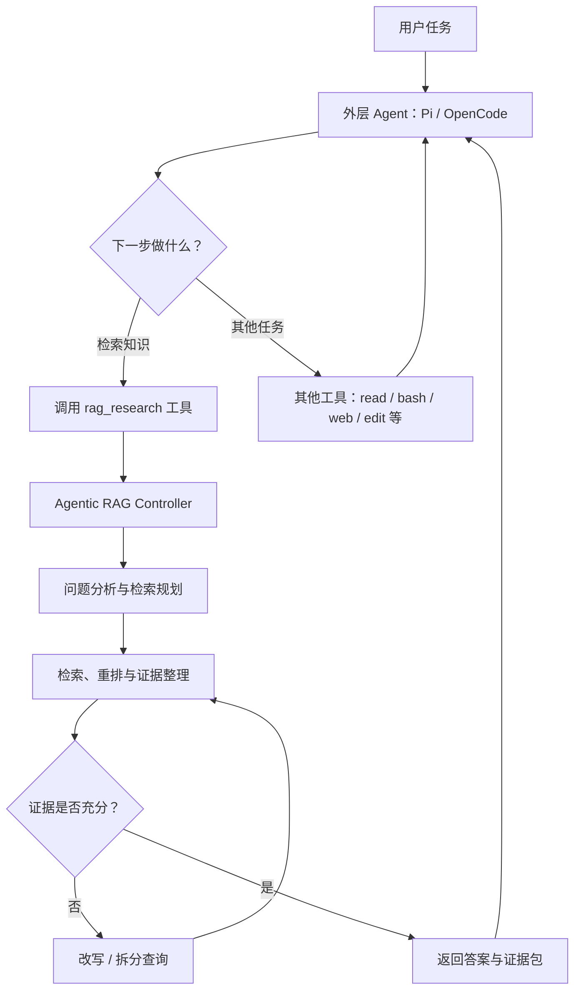
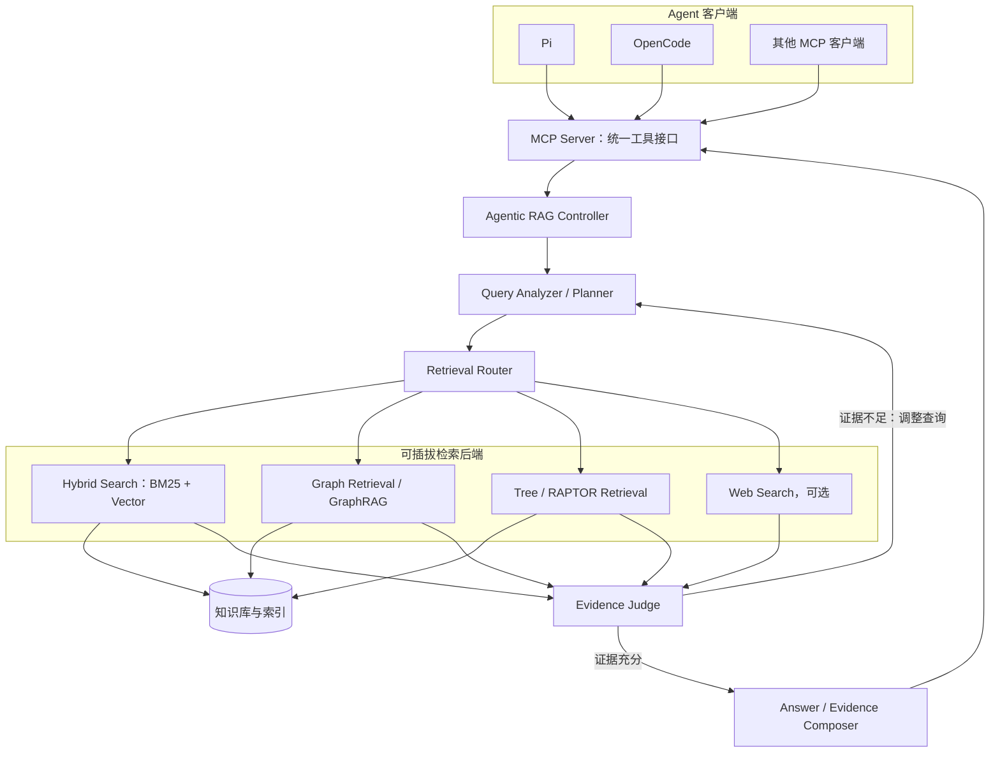

# Agentic RAG：架构设计与落地实践

> [!abstract] 核心结论
> **Agentic RAG 不是某个特定的软件包，而是一种让 Agent 参与检索决策、检索过程可以动态调整的架构模式。**
>
> 一条实用路线是：先把普通 RAG 封装成独立 Retrieval Service，再增加负责问题分析、检索规划、证据评估和查询迭代的 Controller，最后通过 **MCP** 将能力提供给 Pi、OpenCode 等 Agent。

## 1. Agentic RAG 是什么？

### 1.1 普通 RAG 与 Agentic RAG

普通 RAG 通常采用预先定义好的检索流水线：

```text
用户问题
  ↓
Embedding / Query Processing
  ↓
向量检索或关键词检索
  ↓
Top-K 结果
  ↓
Rerank（可选）
  ↓
构造上下文
  ↓
LLM 生成回答
```

检索步骤主要由开发者预先确定。无论问题简单还是复杂，系统大体沿着既定 Pipeline 运行。

Agentic RAG 则让模型或 Controller 参与检索过程中的决策：

```text
用户问题
  ↓
分析问题与信息缺口
  ↓
规划检索策略
  ↓
选择检索源与查询方式
  ↓
检索、重排、整理证据
  ↓
判断证据是否充分
  ├─ 充分 → 生成回答
  └─ 不充分 → 改写 / 拆分查询 → 再次检索
```

**关键区别不在于是否使用向量数据库，而在于检索流程是否能够根据问题和当前证据动态调整。**

### 1.2 几个相关概念的边界

| 概念 | 主要解决的问题 | 与 Agentic RAG 的关系 |
|---|---|---|
| RAG | 如何把外部知识检索到生成上下文中 | 基础能力 |
| Agent + RAG Tool | Agent 能否调用检索工具 | 是入门形式，但检索内部可能仍是固定流程 |
| Agentic Retrieval / Agentic RAG | 如何动态规划、选择、调整和评估检索 | 本文重点 |
| GraphRAG | 如何利用图结构、实体关系或图上的检索策略组织知识 | 一种可被 Agentic RAG 调用的检索后端或策略 |
| RAPTOR / Tree Retrieval | 如何通过层次化摘要或树结构检索多层次信息 | 一种检索组织方式，不等同于 Agentic RAG |
| Context Database / Agent Memory | 如何组织、持久化与按需加载 Agent 上下文或记忆 | 与知识检索有关，但关注点不同 |

因此：

- `GraphRAG ≠ Agentic RAG`
- `RAPTOR ≠ Agentic RAG`
- 使用向量数据库不代表系统就是 Agentic RAG。
- 固定的 Hybrid Search 可以作为 Agentic RAG 的底层能力。

## 2. 两层 Agent：外层任务执行，内层负责检索

当 Agent 本身已经有 ReAct Loop 时，可以把整个系统划分为两个逻辑层。



### 外层 Agent：负责完整任务

例如，用户要求“分析某个 GitHub 项目并修改代码”。外层 Agent 决定什么时候读取文件、搜索网页、查询知识库、修改代码以及运行测试。

### 内层 Agentic RAG：负责知识获取

它只负责检索相关知识、评估证据和补足信息缺口。例如，针对“某个架构决策为什么这样设计”，它可以自动拆分问题、尝试不同检索方式、扩展上下文并判断证据是否充分。

> [!important] 职责边界
> 不要让两个层级都承担完整任务编排。外层负责“整个任务怎么完成”，内层负责“如何取得足够可靠的知识证据”。

## 3. 三种落地方式

### 方式 A：把普通检索当作工具

```text
Pi / OpenCode
    └── knowledge_base_search(query)
          └── 固定检索 Pipeline
```

这是最简单的方案。Agent 能自主决定是否调用搜索工具，但工具内部可能仍然只执行固定的 `vector → BM25 → rerank` 流程。

适合先验证知识库能否被 Agent 使用；但不能仅凭这一点就认为检索本身已经具备较强的 Agentic 能力。

### 方式 B：把 Agentic RAG 封装成一个高层工具（推荐）

```text
Pi / OpenCode
    └── rag_research(query)
          └── Query Planner
                ↓
              Retrieval Router
                ↓
              Hybrid Search / Graph / Tree
                ↓
              Reranker
                ↓
              Evidence Judge
               ├── 充分 → 组织结果
               └── 不足 → Query Rewrite → 再检索
```

对外只暴露一个相对稳定的工具，内部可以持续调整算法和后端。外层 Agent 无须知道底层究竟使用 pgvector、Elasticsearch、Qdrant 还是图检索。

**这是第一版最推荐的实现方式：内部可以逐步演进，对外接口尽量保持稳定。**

### 方式 C：把检索能力做成独立的 RAG Agent

```text
主 Agent
    ↓
Research Agent / RAG Agent
    ├── 知识库检索
    ├── 网页搜索
    ├── 证据比对
    ├── 迭代查询
    └── 输出研究报告
```

这更接近 Deep Research Agent。它适合多步骤、跨来源的研究任务，但也会带来更多 Token 消耗、调用延迟、状态管理和调试复杂度。

建议先实现方式 B，再根据实际需求决定是否需要独立的子 Agent。

## 4. 推荐目标架构



架构可分为四层：

1. **客户端层**：Pi、OpenCode 或其他 Agent。
2. **协议 / 工具层**：通过 MCP 暴露稳定接口。
3. **Agentic Controller 层**：完成问题分析、策略规划、重试与证据判断。
4. **检索后端层**：封装向量、关键词、图、树或网页等检索能力。

这四层分开之后，客户端、检索策略与数据存储可以相对独立地变化。

## 5. 工具接口如何设计

第一版不必向 Agent 暴露大量底层检索工具。可以从三个接口开始。

### 5.1 `rag_search(query)`

执行一次普通检索，返回候选证据。适用于快速查询、调试和外层 Agent 自主编排。

示意返回：

```json
{
  "results": [
    {
      "chunk_id": "chunk-123",
      "document_id": "tls13-notes",
      "text": "候选文本片段……",
      "score": 0.91,
      "source": "tls13.pdf",
      "page": 17
    }
  ]
}
```

### 5.2 `rag_fetch(chunk_id, expand)`

根据命中的 chunk 或文档标识获取更多上下文。例如：

- 获取 chunk 对应的原文。
- 向上扩展到 parent chunk 或相邻段落。
- 返回文档标题、页码、URL 等来源元数据。

它可以实现“子块精确召回，再扩展父级上下文”的检索模式。

### 5.3 `rag_research(query)`

负责完整的 Agentic Retrieval 流程。它不只是返回 Top-K，而是尝试整理出回答问题所需的证据，并在必要时重新检索。

```text
rag_research(query)
    1. 分析问题、实体和信息缺口
    2. 规划查询或拆分子问题
    3. 选择检索后端和检索策略
    4. 检索并合并候选结果
    5. 重排候选证据
    6. 判断证据覆盖度与可信度
    7. 不足时改写查询并重试
    8. 输出证据、出处和检索摘要
```

## 6. 检索控制器的核心逻辑

最小版本不需要一开始就使用多 Agent 框架。可以用一个有边界的 Controller 管理检索循环。

```python
while not finished:
    plan = analyze_query(query)
    candidates = retrieve(plan)
    evidence = rerank(candidates)

    assessment = evaluate_evidence(
        query=query,
        evidence=evidence,
    )

    if assessment.is_sufficient:
        finished = True
    else:
        query = rewrite_query(
            query=query,
            evidence=evidence,
            missing_information=assessment.missing_information,
        )

return build_result(query=query, evidence=evidence)
```

这只是控制流程示意。真正实现时需要加上最大迭代次数、超时、Token / 成本预算、重复查询检测和失败处理，避免无休止地循环。

### 建议的核心模块

| 模块 | 职责 |
|---|---|
| `analyzer.py` | 识别问题类型、实体、约束和信息缺口 |
| `planner.py` | 生成单次或多步检索计划 |
| `router.py` | 选择向量、关键词、图、树或外部搜索 |
| `retriever/` | 各类检索后端的统一封装 |
| `reranker.py` | 对召回内容进一步排序 |
| `evaluator.py` | 判断证据是否覆盖问题、是否存在明显冲突 |
| `rewriter.py` | 根据缺失信息生成新的检索查询 |
| `controller.py` | 控制整个检索循环，执行预算和终止策略 |
| `composer.py` | 组织答案、引用和证据包 |
| `mcp/server.py` | 将上述能力通过 MCP 暴露给客户端 |

## 7. 为什么建议用 MCP 接入 Pi、OpenCode 等 Agent？

如果只为 Pi 开发专用扩展，或者只为 OpenCode 写自定义工具，检索服务就容易与特定客户端绑定。

使用 MCP 作为服务接口，可以形成：

```text
Pi ─────────┐
OpenCode ────┼── MCP ── Agentic RAG Service ── Retrieval Backends
其他客户端 ─┘
```

MCP 在这里是**工具互操作层**，不是 Agentic RAG 算法本身。它负责标准化地描述和调用工具；具体的查询规划、检索、重试和证据判断仍由你的服务实现。

### 7.1 OpenCode 接入思路

OpenCode 支持配置 MCP Server。可以把本地 Python 服务注册为一个 MCP 工具服务，然后让 OpenCode 在需要时调用 `rag_search`、`rag_fetch` 或 `rag_research`。

配置示意（具体字段以当前版本文档为准）：

```json
{
  "$schema": "https://opencode.ai/config.json",
  "mcp": {
    "rag": {
      "type": "local",
      "command": ["uv", "run", "python", "mcp_server.py"]
    }
  }
}
```

基本调用链：

```text
OpenCode → MCP Tool → rag_research → Controller → 检索后端
```

也可以以后为 OpenCode 单独实现原生 Custom Tool / Plugin，但这不是第一版的必要条件。

### 7.2 Pi 接入思路

Pi 可以通过扩展注册工具，也可以使用 MCP 扩展连接 MCP Server。

```text
Pi → MCP 扩展 / 客户端 → Agentic RAG MCP Server
```

如果需要与 Pi 的运行时深度集成，例如根据会话状态动态启用工具、调整上下文或定制交互，再考虑开发 Pi 原生 Extension。第一版通常可以先通过 MCP 打通调用链。

> [!note] 版本提示
> Pi 和 OpenCode 的扩展机制、MCP 配置格式会随版本演进。本文中的配置只用于说明集成方式，实际使用前应对照官方文档核对字段与安装步骤。

## 8. 结构化返回：不要只返回一大段文本

建议将检索结果整理成可供外层 Agent 继续推理的结构化 **Evidence Bundle**。

```json
{
  "answer": "基于现有证据得到的阶段性结论……",
  "evidence": [
    {
      "document_id": "tls13-notes",
      "chunk_id": "chunk-123",
      "text": "支持结论的原文片段……",
      "source": "tls13.pdf",
      "page": 17,
      "score": 0.93
    }
  ],
  "retrieval_trace": [
    {
      "query": "TLS 1.3 certificate fragmentation",
      "strategy": "hybrid"
    },
    {
      "query": "post-quantum certificate size MTU",
      "strategy": "hybrid"
    }
  ],
  "assessment": {
    "sufficient": true,
    "missing_information": []
  }
}
```

结构化结果有几个好处：

- 外层 Agent 可以检查来源并决定是否继续追问或检索。
- 答案和证据分离，便于引用、审计和验证。
- 可以保留精简的检索轨迹，方便调试；不必把所有内部细节都塞进上下文。
- 不同检索后端可以统一映射到同一返回结构。

注意：`score` 通常是检索或排序分数，不应直接等同于事实正确概率。`confidence` 或充分性判断也应有明确含义，最好结合证据覆盖度、来源质量和冲突检测，而不是只依赖模型口头自评。

## 9. 检索后端与索引策略

Agentic RAG 的 Controller 可以独立于后端存储。后端按需求逐步增加，不需要一次全部实现。

| 后端 / 方法 | 主要用途 | 建议阶段 |
|---|---|---|
| BM25 / 关键词检索 | 精确术语、错误码、标识符、专有名词 | 第一阶段 |
| 向量检索 | 语义相似、不同表述之间的召回 | 第一阶段 |
| Hybrid Search | 结合关键词和语义召回，常作为基础检索策略 | 第一阶段 |
| Reranker | 对候选片段做第二阶段排序 | 第一阶段或紧接着加入 |
| Parent / Context Expansion | 将精确命中的 chunk 扩展到更完整上下文 | 第一至第二阶段 |
| GraphRAG / 图检索 | 实体关系、跨文档关系、多跳查询 | 有明确需求后再加 |
| RAPTOR / Tree Retrieval | 分层摘要、跨段落或更高层次主题检索 | 有明确需求后再加 |
| Web Search | 本地知识库覆盖不足或需要外部新信息时补充 | 可选 |

如果已有 PostgreSQL / pgvector，可以先保留它作为知识存储，并组合关键词检索、向量检索、混合排序和 reranker。第一版不必为了“Agentic”这个标签就切换数据库。

## 10. 开源项目参考

建议按“理解模式 → 学习工作流 → 观察完整服务”的顺序阅读，而不是一开始就同时部署多个平台。

| 项目 | 主要定位 | 值得学习的方面 | 更适合的用途 |
|---|---|---|---|
| [LlamaIndex](https://github.com/run-llama/llama_index) | 数据框架、RAG 与 Agent | Query Engine Tool、路由、子问题分解、Agent 调用检索 | 理解 Agent 与 RAG 如何组合 |
| [Haystack](https://github.com/deepset-ai/haystack) | Pipeline 与 Agent 工作流框架 | 条件分支、循环、PipelineTool、检索失败后的回退 | 学习显式、可控的检索流程 |
| [R2R](https://github.com/SciPhi-AI/R2R) | RAG / Agentic Retrieval 服务 | 如何把检索封装成可部署的服务与 API | 参考独立 Retrieval Service 的产品形态 |
| [RAGFlow](https://github.com/infiniflow/ragflow) | 完整 RAG 平台 | 文档解析、知识库构建、检索与 Agent 功能的集成 | 研究较完整的系统工程实践 |
| [RAG_Techniques](https://github.com/NirDiamant/RAG_Techniques) | RAG 技术示例集合 | 查询改写、复杂任务规划、自适应检索、验证 | 学习与实验具体技术模式 |
| [Microsoft GraphRAG](https://github.com/microsoft/graphrag) | 基于图结构的检索方法 | 实体关系、图构建、全局与局部检索思路 | 研究 GraphRAG，不等于直接采用整个 Agent 架构 |
| [OpenViking](https://github.com/volcengine/OpenViking) | 面向 Agent 的上下文 / 记忆基础设施 | 上下文组织、按需检索和渐进式加载 | 研究 Context Database 与 Agent Memory 的组织方式 |

### 推荐阅读顺序

1. **LlamaIndex**：先理解 Agent 如何把 RAG / Query Engine 当作工具调用。
2. **Haystack**：理解如何用显式 Pipeline、条件分支和循环控制检索工作流。
3. **RAG_Techniques**：针对查询改写、检索路由和证据评估做小实验。
4. **R2R / RAGFlow**：研究如何将检索能力服务化，以及完整平台的工程取舍。
5. **GraphRAG / OpenViking**：在基础版本跑通以后，再分别深入图检索与上下文基础设施。

开源项目迭代较快。选型前应再次查看各项目的最新 README、文档、维护状态和许可证，尤其不要只凭项目名称判断其是否适合作为生产依赖。

## 11. 推荐项目目录

一个便于逐步实现、又不与某个 Agent 客户端绑定的 Python 项目可以这样组织：

```text
agentic-rag/
├── ingestion/
│   ├── parser.py
│   ├── cleaner.py
│   ├── chunker.py
│   └── indexer.py
├── retrieval/
│   ├── dense.py
│   ├── bm25.py
│   ├── hybrid.py
│   ├── reranker.py
│   ├── context_expansion.py
│   └── graph.py              # 后续按需添加
├── agentic/
│   ├── analyzer.py
│   ├── planner.py
│   ├── router.py
│   ├── evaluator.py
│   ├── rewriter.py
│   ├── composer.py
│   └── controller.py
├── mcp/
│   └── server.py
├── evaluation/
│   ├── dataset.py
│   └── evaluate.py
├── tests/
├── pyproject.toml
└── README.md
```

其中 `retrieval/` 负责“如何查”，`agentic/` 负责“决定查什么、如何调整”，`mcp/` 负责“如何让外部 Agent 调用”。不要把所有逻辑塞进 MCP Server 文件中。

## 12. 分阶段实施路线

### Phase 1：先有可用的普通 RAG

实现文档解析、切分、索引和基础检索。如果已有可用 RAG，直接复用，不必重建。

交付标准：能根据问题召回相关片段，并保留文档标识、页码、URL 等来源信息。

### Phase 2：整理稳定的检索 API

实现 `rag_search()` 和 `rag_fetch()`，统一输入输出结构，隔离底层数据库实现。

交付标准：不依赖 Pi 或 OpenCode，也可以通过命令行或测试程序调用。

### Phase 3：加入 Agentic RAG Controller

依次加入问题分析、查询改写、检索路由、证据充分性判断和有限次数重试。

交付标准：遇到证据不足的问题，可以解释信息缺口并尝试新的查询；达到预算或最大重试次数时能正常退出。

### Phase 4：通过 MCP 暴露 `rag_research()`

将内部 Controller 包装成 MCP 工具，并接入 Pi、OpenCode。

交付标准：不同 MCP 客户端能够使用相同的核心检索服务，算法逻辑不复制到各客户端插件里。

### Phase 5：增强检索能力

根据评测数据与实际失败案例，再考虑加入 GraphRAG、RAPTOR、上下文扩展、网页搜索回退或不同的检索器。

交付标准：每增加一种策略，都能说明它解决了哪类已观察到的失败案例。

### Phase 6：评测、追踪与治理

为检索和回答建立测试集，记录查询、路由策略、召回结果、引用与失败原因。评估召回质量、答案正确性、引用可靠性、延迟和成本。

交付标准：策略调整有可比较的指标，而不是只凭几个手工示例判断效果。

## 13. 第一版 MVP 的范围建议

推荐的 MVP 组合：

- **语言与服务**：Python。
- **知识存储**：已有 PostgreSQL / pgvector 可继续使用。
- **检索策略**：BM25 + 向量检索 + Hybrid Search。
- **排序**：先做基础融合；需要时加入 Reranker。
- **Agentic 能力**：Query Analysis、Query Rewrite、Evidence Judge、有限次数 Retry。
- **对外接口**：MCP Server。
- **接入客户端**：先选 Pi 或 OpenCode 中一个验证，再接另一个。

第一版暂时不做：复杂多 Agent 编排、完整 GraphRAG、RAPTOR、过多可配置的检索模式，以及大量客户端专用插件。

### MVP 验收清单

- [ ] 普通查询可以返回可追溯的候选证据。
- [ ] 命中结果支持回取原文或扩展上下文。
- [ ] 能识别明显的证据缺口并改写查询。
- [ ] 检索循环有最大轮数、超时和成本上限。
- [ ] 返回结构包含来源标识、文本片段和检索过程摘要。
- [ ] 通过 MCP 对外提供统一工具接口。
- [ ] Pi 或 OpenCode 至少有一个完成端到端调用。
- [ ] 有一组固定测试问题，可对比改造前后的检索表现。

## 14. 关键设计原则

1. **先服务化，再智能化**：先把检索能力变成边界清楚、可测试的接口，再引入动态决策。
2. **外层与内层分工明确**：主 Agent 管整个任务；Agentic RAG 管检索和证据。
3. **MCP 是接口，不是算法**：MCP 解决不同客户端如何调用服务的问题，不会自动让 RAG 变得 Agentic。
4. **后端可插拔**：将 BM25、向量、图、树和网页检索封装为统一接口。
5. **证据优先于流畅度**：保留来源和引用，区分检索分数与事实可信度。
6. **循环必须有边界**：限制迭代次数、延迟、Token 和费用，避免反复搜索。
7. **用评测决定复杂度**：只有当基线方案暴露出明确短板时，才增加 GraphRAG、RAPTOR 等机制。

## 15. 参考资料

- [LlamaIndex GitHub](https://github.com/run-llama/llama_index)
- [LlamaIndex Agentic Strategies](https://docs.llamaindex.ai/en/stable/module_guides/deploying/agents/agentic_strategies/)
- [Haystack GitHub](https://github.com/deepset-ai/haystack)
- [Haystack Agentic RAG 文档](https://docs.haystack.deepset.ai/docs/agentic-rag)
- [R2R GitHub](https://github.com/SciPhi-AI/R2R)
- [RAGFlow GitHub](https://github.com/infiniflow/ragflow)
- [RAG_Techniques GitHub](https://github.com/NirDiamant/RAG_Techniques)
- [Microsoft GraphRAG GitHub](https://github.com/microsoft/graphrag)
- [OpenViking GitHub](https://github.com/volcengine/OpenViking)
- [OpenCode MCP 文档](https://opencode.ai/docs/mcp-servers/)
- [OpenCode Custom Tools 文档](https://opencode.ai/docs/custom-tools/)
- [Pi 文档](https://pi.dev/docs/latest/extensions)
- [MCP Python SDK](https://github.com/modelcontextprotocol/python-sdk)

---

## 一句话总结

**不要先寻找一个名叫 Agentic RAG 的成品然后把它塞进 Pi / OpenCode；更可控的做法是复用现有 RAG，构建一个带检索规划与证据评估的 Controller，将它服务化，再通过 MCP 让多个 Agent 共用。**
